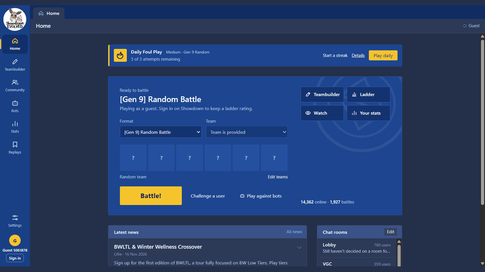

<p align="center">
  
</p>

# Pokemon Showdown Evolved

A free, open-source Windows desktop app for [Pokémon Showdown](https://play.pokemonshowdown.com/). Play online, calculate damage with Showdex, practise against bots, and keep notes on your replays in one workspace.

**Windows preview:** [Download Pokemon Showdown Evolved v0.2.0](https://github.com/influxtion/Pokemon-Showdown-Launcher-App/releases/tag/v0.2.0). Open the release and download the `.exe` under **Assets**. No Git or Node.js is needed to install it.

This is an unsigned early release for Windows x64. Windows may show an unknown-publisher or SmartScreen warning. Clean-PC installation and signed-in acceptance testing are still pending. Updates are manual: download a newer installer from the same Releases page.

## Demo



A short slideshow of actual app captures: Home in dark mode, a Foul Play battle with Showdex, and Bots and Settings in light mode. Captured in isolated test profiles; no personal account data is shown. [View the battle screenshot](assets/readme/battle.png).

## Features

- **Online play:** the official Showdown client, your existing account, teambuilder, chat, friends, and ladder stats. Battles stay connected while you switch pages.
- **Showdex:** optional damage calculations beside online and bot battles. Install it on first launch or from Settings.
- **Bot practice:** Foul Play in Gen 9 Random Battle and OU, with Medium and Casual variants for Random Battle. Use the cloud service or explicitly download Foul Play for local play. Three simpler bots are also available.
- **Daily Foul Play:** three attempts each UTC day against Medium, with local streaks and clear history.
- **Replay notes:** bookmark replay links, write notes, watch replays alongside them, and import or export backups with conflict review.
- **Your workspace:** light and dark themes, two Home layouts, adjustable battle width, and keyboard shortcuts for tabs and notes.

Online play requires an internet connection. Cloud practice depends on service availability. Practice is separate from your Showdown account and the public ladder; the app never searches, challenges, or chooses moves on your online account automatically.

## Run from source

Requires **Windows x64**, **Node.js 24**, and **Git**. The first builds need internet access to retrieve the pinned upstream sources.

```powershell
git clone https://github.com/influxtion/Pokemon-Showdown-Launcher-App.git
cd Pokemon-Showdown-Launcher-App
npm ci
npm run build:practice
npm run build:showdex
npm start
```

Choose a Home layout on first launch, then install Showdex or skip it. Sign in through Showdown for online play, or open **Bots** for practice. Foul Play runs in the cloud by default; its local download is optional.

Settings and replay notes stay on your computer. Replays themselves remain hosted by Showdown. Existing profiles continue using `%APPDATA%\showdown-desktop` after the rename to Evolved.

## Development

```powershell
npm run check
npm test
npm run test:desktop
```

Optional live checks include `test:startup:live`, `test:shell:live`, `test:showdex:live`, `test:showdex:dock`, and `test:replays:live`. These use isolated profiles. `test:practice:showdex` also requires the developer Foul Play runtime installed with `npm run api:setup`.

- [App design, security, testing, and packaging](docs/design.md)
- [Practice bots and runtime setup](docs/bots.md)
- [Practice API and deployment](api/README.md)

Signed-in account flows and clean-machine installer acceptance still need manual verification. Automated checks do not replace those release checks.

## Mascot and credits


Eevee is our mascot. The logo is supplied by the project owner; the pixel sprite comes from [Pokémon Showdown](https://play.pokemonshowdown.com/sprites/gen5/eevee.png).

Built with [Electron](https://www.electronjs.org/), [Pokémon Showdown](https://github.com/smogon/pokemon-showdown), [Showdex](https://github.com/doshidak/showdex), and [Foul Play](https://github.com/pmariglia/foul-play).

This is an independent fan project, not affiliated with Pokémon Showdown, Smogon, Nintendo, Game Freak, or The Pokémon Company.

## License

The app is licensed under [AGPL-3.0-or-later](LICENSE). Third-party components retain their own licenses: the practice client and Showdex use AGPL-3.0, the simulator uses MIT, and Foul Play uses GPL-3.0. Bundled components include their license and required source materials. Showdex is included as an optional install payload; Foul Play is downloaded only when requested.

Pokémon names and artwork belong to their respective owners and are not covered by the app's software license.
