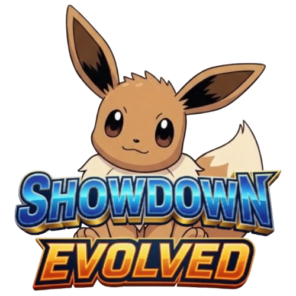
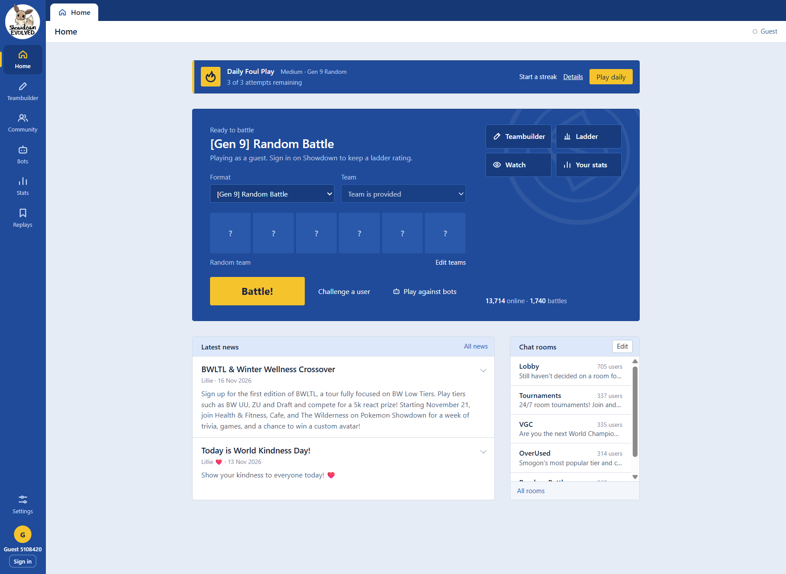

  

# Pokemon Showdown Evolved

Pokemon Showdown Evolved is a free, open-source desktop app for [Pokémon Showdown](https://play.pokemonshowdown.com/). It includes a modernized look with a convenient system and additional features, like playable bots, replay notes, and team building tools.

[Download Pokemon Showdown Evolved v0.2.0](https://github.com/influxtion/Pokemon-Showdown-Launcher-App/releases/tag/v0.2.0). Open the release and download the `.exe` under **Assets**. No Git or Node.js is needed to install it.

This is an unsigned early release for Windows x64. Windows may show an unknown-publisher or SmartScreen warning. Clean-PC installation and signed-in acceptance testing are still pending. Updates are manual: download a newer installer from the same Releases page.

## Home preview

The modern Home layout in light mode, captured from the running app in an isolated guest profile. Click the image to view it at full resolution. [See a Foul Play battle with Showdex](assets/readme/battle.png).

## Features

- **Online play:** The official Showdown client modernized with a clean, restyled look and collected all together
- **Bot practice:** Practice against the best bots in competitive Pokemon with just a click, like how Chess and other competitive games do it. Test teams and your skill
- **Showdex:** Optional damage calculations integrated. Install it on first launch or from Settings
- **Daily Foul Play:** three attempts each day against Medium difficulty, with local streaks and clear history. Keep sharp and work towards winning
- **Replay notes:** Bookmark replay links, write notes, watch replays alongside them, and import or export backups with conflict review.
- **Your workspace:** Light and dark themes, two Home layouts, adjustable battle width, and keyboard shortcuts for tabs and notes.

Online play requires an internet connection. Bot practice is separate from your Showdown account and the public ladder; the app never searches, challenges, or chooses moves on your online account automatically.

Choose a Home layout on first launch, then install Showdex or skip it. Sign in through Showdown for online play, or open **Bots** for practice. Foul Play runs in the cloud by default; its local download is optional.

## Mascot and credits

Eevee is our mascot. The pixel sprites comes from [Pokémon Showdown](https://play.pokemonshowdown.com/sprites/gen5/eevee.png).

Built with [Electron](https://www.electronjs.org/), [Pokémon Showdown](https://github.com/smogon/pokemon-showdown), [Showdex](https://github.com/doshidak/showdex), and [Foul Play](https://github.com/pmariglia/foul-play).

This is an independent fan project, not affiliated with Pokémon Showdown, Smogon, Nintendo, Game Freak, or The Pokémon Company.

## License

The app is licensed under [AGPL-3.0-or-later](LICENSE). Third-party components retain their own licenses: the practice client and Showdex use AGPL-3.0, the simulator uses MIT, and Foul Play uses GPL-3.0. Bundled components include their license and required source materials. Showdex is included as an optional install payload; Foul Play is downloaded only when requested.

Pokémon names and artwork belong to their respective owners and are not covered by the app's software license.
