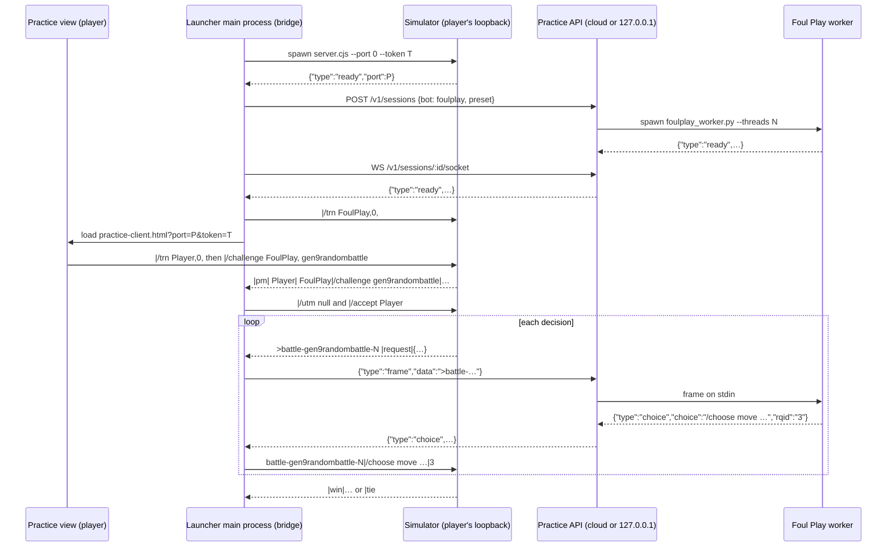

# Practice bots: how they work

This is the single reference for how the bots work.

## Contents

1. [Overview](#1-overview)
2. [Where the bots run](#2-where-the-bots-run)
3. [Protocols](#3-protocols)
4. [The search engine](#4-the-search-engine-poke-engine-mcts)
5. [Foul Play](#5-foul-play)
6. [Running and hosting](#6-running-and-hosting)

## 1. Overview

The Bots page offers seven opponents on a private simulator. **Foul Play**, **Foul Play Medium**, and **Foul Play Casual** support Gen 9 Random Battle, OU, and Anything Goes. **Metamon (Kakuna)** supports Gen 9 OU through the cloud API or an optional local download. **Heuristic**, **Greedy**, and **Random** are simple local Gen 9 Random Battle bots. OU and Anything Goes require both teams from the Teambuilder or pasted exports. All teams are checked with the simulator's validator for the selected format.

Foul Play and Metamon default to the cloud. The Downloads tab offers one card per engine, without difficulty groups, with download, cancel, remove and independent Cloud server / This computer choices. Large models and runtimes are downloaded only on request and are not bundled in the app installer. Cloud cards check the host's advertised per-bot formats; older hosts cannot start newly supported combinations. Metamon stays unavailable until its separate server runtime is configured.

Most of this document describes Foul Play. It sees only its own battle seat, samples plausible hidden opposing sets, searches each sampled world with a Rust engine, and combines the results.

| | Foul Play |
| --- | --- |
| Author, license | pmariglia, GPL-3.0 |
| Pinned revision | `8f541f8` |
| Protocol client | Foul Play's own battle parser, fed through a stdio link |
| Engine | poke-engine 0.0.48 |
| Worlds × time per decision | 4 × 50 ms early, else 2 × 100 ms (Hard) |
| Set data | pkmn/randbats counted sets |
| Unseen slots | Random species under team-generation rules |
| Combining | Weighted sum of visit shares |
| After search | Random among options ≥ 75% of best (Hard) |
| Rejected choice | Session ends |
| Adapter | `api/worker/foulplay_worker.py` (through the practice API) |

Presets set the engine's search threads and nothing else: **Quiet** 1, **Balanced** 2, **Full** 8 (default; a cloud server may cap it with `MAX_THREADS`). They are CPU budgets, not difficulty levels. The Bots page offers no choice: the launcher always sends **Full**.

## 2. Where the bots run

The **simulator always runs on the player's computer**, started by the launcher for each practice session. Only the bot's decisions are computed elsewhere, by the **practice API** (`api/server.js`): by default on the cloud server, a host deployed from `api/` ([api/README.md](../api/README.md)). A player can opt in to running Foul Play on their own computer: the Bots page downloads it with the same installer the server uses (`api/install.js`), and the app then runs the same API server on 127.0.0.1 with a private key, at below-normal priority. Nothing is downloaded unless the player asks. Tests run the same server on loopback as a stand-in for the cloud.

For every session the launcher's `PracticeSession` (`app/practice-session.js`):

1. starts the **simulator**, the pinned Showdown server (`scripts/practice/server.cjs`), bound to `127.0.0.1` on an OS-chosen port and protected by a fresh 256-bit token;
2. creates an **API session**, for which the server starts one Foul Play **worker** process (`api/worker/foulplay_worker.py`), and opens its socket;
3. connects a **bridge** to the simulator as `FoulPlay`. The bridge accepts the player's challenge, forwards that battle room's frames to the API and sends back the choices it returns.



### Simple bots (`app/simple-bots.js`)

Random, Greedy and Heuristic skip step 2: the same bridge logs in as `RandomBot`, `GreedyBot` or `HeuristicBot` and hands the battle frames to a `LocalBot` in the launcher instead of the API, so they need no cloud server and no internet connection. They are written from scratch and use no Foul Play code (which is GPL-3.0); move, species and type data come from the shipped simulator's own data files (`server/dist/data`, MIT). Each bot keeps a small picture of the battle from the log (both active Pokemon, HP, status, boosts, Tera, revealed moves and abilities, hazards) and answers every `|request|` about 40 ms later, once that turn's log has arrived. Every choice is built from the request, by move position, so it is always legal; if the simulator rejects one anyway, the bot sends `/choose default` rather than stall.

| Bot | Plays |
| --- | --- |
| Random | A random usable move; switches at random about 15% of the time when it could attack |
| Greedy | The move with the biggest estimated immediate damage; never switches by choice |
| Heuristic | Takes a KO when it can, switches out of bad matchups (not twice in a row), sets each hazard and status move once, heals when low, sets up to +2 when safe, otherwise attacks; Tera only when it changes the result |

Damage is a quick estimate: the standard formula with stats, boosts, STAB, type effectiveness, burn and accuracy, and an average roll. The opponent's stats are estimated from its species and level with Random Battle spreads (84 EVs, 31 IVs, neutral nature); items and abilities are ignored apart from Levitate. Tests: `tests/simple-bots.test.js` (needs `npm run build:practice`) and `tests/practice-session.test.js`.

*(2026-11-17)* On the real simulator, 20 battles per pairing with no rejected choices: Random vs. Random 11–9, Greedy vs. Random 20–0, Heuristic vs. Random 20–0, Heuristic vs. Greedy 12–8.

## 3. Protocols

Four layers sit between the player and a decision. With the cloud server, only the first crosses the internet.

### 3.1 Launcher ↔ practice API (HTTPS + WebSocket)

| Route | Purpose |
| --- | --- |
| `GET /healthz` | Process health only |
| `GET /v1/info` | Bots, presets after the server's thread cap, limits and capacity |
| `POST /v1/sessions` | Body `{"bot", "preset", "format"?, "team"?}`: bot `foulplay`, `foulplay-medium` or `foulplay-casual`; preset `quiet`, `balanced` or `full`; format `gen9randombattle` (default) or `gen9ou` (Hard only), which needs `team`, Foul Play's own team as a Showdown export → session ID (random 256-bit hex), level, format and thread count |
| `GET /v1/sessions/:id` | State, battles and decisions |
| `DELETE /v1/sessions/:id` | Stop the worker and clean up |
| `WS /v1/sessions/:id/socket` | Frames in (`{"type":"frame","data":…}`), `ready`, `battle`, `thinking`, `choice`, `end` and `error` out |

- Anonymous by default; an `API_KEY` makes every `/v1` call and socket need `Authorization: Bearer <key>`. Test stand-ins on loopback always use a random key.
- Only frames for a battle room of the session's format (`battle-gen9randombattle-N` or `battle-gen9ou-N`) are accepted, up to 256 KiB each. Bursts of 200 frames, then 40 per second. Requests with an `Origin` header (browsers) cannot open a socket.
- A choice must be `/choose move <id>`, optionally followed by ` terastallize`, or `/switch <1-6>`. The server and the launcher both check this before anything reaches the simulator.
- Per client network: 1 concurrent session, and session creation in bursts of 6 refilling at 30 per hour. Server-wide: `MAX_SESSIONS` and `MAX_THREADS`. Sessions end after 2 hours, 15 minutes idle, 1 minute without a socket, 5,000 decisions, or when the socket closes. Full details are in [api/README.md](../api/README.md#rate-limits).

### 3.2 Showdown WebSocket protocol (player and bridge ↔ simulator)

Both the player's client and the bridge speak the standard [Pokémon Showdown protocol](https://github.com/smogon/pokemon-showdown/blob/master/PROTOCOL.md) to the same simulator. Client → server frames are `ROOMID|TEXT` (empty room for global commands). Server → client frames are newline-separated `|TYPE|…` lines, prefixed with `>ROOMID` when they belong to a room.

The simulator accepts a WebSocket only from `127.0.0.1`, with the exact `Host` header and the exact path `/showdown/websocket?token=<session token>`; every other HTTP request gets 404. There is no login server: unregistered names are accepted.

| Step | Direction | Messages |
| --- | --- | --- |
| Log in | server → bot | `\|challstr\|…` |
| | bot → server | `\|/trn FoulPlay,0,` (or the simple bot's name) |
| | server → bot | `\|updateuser\| FoulPlay\|1\|…` (the `1` means named); the bot is now ready |
| Challenge | player → server | `\|/trn Player,0,`, then `\|/utm null` (OU: `\|/utm <player's packed team>`) and `\|/challenge FoulPlay, gen9randombattle` (or `gen9ou`), sent by `vendor/practice/client-bootstrap.js` |
| | server → bot | `\|pm\| Player\| FoulPlay\|/challenge gen9randombattle\|gen9randombattle\|…` |
| | bot → server | `\|/utm null` (OU: `\|/utm <Foul Play's packed team>`) then `\|/accept Player` |
| Battle start | server → both | `>battle-gen9randombattle-N`, `\|init\|battle`, `\|title\|Player vs. FoulPlay`, team and `\|request\|{JSON}` |
| Decision | server → bot | `\|request\|{JSON}` with the legal options and request ID (`rqid`); `"wait": true` means no decision is due |
| | bot → server | Foul Play: `battle-…\|/choose move <moveid>[ terastallize]\|<rqid>` or `\|/switch <slot>\|<rqid>` |
| Rejection | server → bot | `\|error\|[Invalid choice] …` or `\|error\|[Unavailable choice] …` |
| Turn | server → both | Event lines (`\|move\|`, `\|switch\|`, `\|-damage\|`, `\|-terastallize\|` …) then `\|turn\|N` |
| End | server → both | `\|win\|<name>` or `\|tie`, then the room closes (`\|deinit`) |

The bridge accepts a challenge only if every field matches: sender `Player`, recipient `FoulPlay`, the session's format, and no battle in progress. OU battles open with team preview, where Foul Play answers `/team <order>`. It adopts only the battle room that opens after it accepts, and stops forwarding at `|win|` or `|tie`. Foul Play's upstream `hf`, `gg` and `/timer on` messages are dropped by the worker, so the battle timer stays off.

### 3.3 Worker ↔ API server (stdio)

The Foul Play worker writes **one JSON object per line** to stdout. stderr carries upstream logs and is never parsed or logged.

**Foul Play worker** (supervised by the API server). Arguments: `--source <absolute Foul Play path> --threads <1-16> --level hard|medium|casual --format gen9randombattle|gen9ou`, or `--check` to verify the runtime for a format and exit. In OU the first stdin line is `{"type":"team","data":<export>}`; then stdin carries `{"type":"frame","data":…}` lines; `{"type":"stop"}` or closing stdin ends it.

| Event | Fields | Meaning |
| --- | --- | --- |
| `ready` | `protocol: 1, bot: "foulplay", level, format, threads, searchMs` | Loaded. The server ends the session unless protocol, bot, level, format and threads match |
| `battle` | `room` | `\|init\|battle` seen; Foul Play is playing this room |
| `thinking` | `room, turn` | A decision is due |
| `choice` | `room, turn, choice, rqid, elapsedMs` | Foul Play's move, already checked against the choice grammar |
| `end` | `room, result` | `win`, `loss` or `tie`, from the bot's side |
| `checked` | `protocol, engine, format` | `--check` only |
| `error` | `code: "engine-failed"` or `"invalid-team"` | Fatal, including a rejected choice or an OU team Foul Play cannot read |

The API server ignores events whose `room` is not `battle-gen9randombattle-<digits>` and clamp numbers to sane ranges. The simulator speaks the same framing: its only event is `{"type":"ready","port":P}`.

The worker's stdin reader waits for space in a 16-frame queue before reading
further. This preserves OS pipe backpressure when the engine falls behind,
allowing the API's existing writable-buffer limit to close a flooding session.
The previous unbounded Python queue bypassed that protection. The November 20
audit covers slow consumers, frame order, malformed/oversized input and API pipe
overflow; `npm test` runs the Python checks with `api/runtime`, a system Python,
or an interpreter path supplied in `PRACTICE_TEST_PYTHON`. Deploy the updated worker to
apply this protection on a hosted API; the audit did not deploy it.

For the existing Linux systemd host, `api/deploy/deploy-audited-worker.sh` applies
only the worker from audit merge `9f7f646`. Run it as the checkout owner. It finds
the service directory, checks pinned file hashes, runs the queue tests and both
format self-checks against the installed runtime, and refuses a busy API. It
retains a backup and restores it if replacement/startup fails. An optional first
argument supplies a non-default runtime directory. The script passed shell
syntax and isolated mock tests for success, busy refusal, failed preflight,
checksum mismatch and restart rollback; it has not been run on the hosted VM.

### 3.4 Network confinement

The Foul Play worker never needs the network: it reads frames from stdin. A Python audit hook (`loopback_only`) still raises on any socket bind, connect, send or DNS lookup that is not IPv4 loopback (Windows asyncio uses a loopback socket pair internally). The simulator replaces outbound `Socket.connect` and `fetch` with functions that throw. The bridge in the launcher sends the simulator only the login, the challenge acceptance and moves that pass the choice grammar.

The sandboxed practice renderer can optionally load installed Showdex. Each fresh practice partition registers its own verified asset handler before creating the view; online cookies, teams and account state remain in the separate online partition. With Showdex enabled, the request filter additionally permits only `showdex://assets/<filename>` (manifest/hash checked by the handler) and GET requests to the four `pkmn.github.io` JSON paths for Gen 9 Random Battle/OU presets and usage data. Queries, uploads, unrelated formats, account/ladder lookups, and other external API requests remain blocked. Showdex uses the player's visible battle state and public presets, not the bot's hidden team data. Its dock shows battle, log, then calculator; narrow windows put the log below controls. `npm run test:practice:showdex` verifies real Foul Play damage calculations and battle lifecycle in a disposable profile.

## 4. The search engine: poke-engine MCTS

Foul Play calls the Rust function, `monte_carlo_tree_search(state, duration_ms, threads)`, on a fully specified battle state. It runs **decoupled UCT** for simultaneous moves:

1. **Select.** At each node, each side independently picks the option with the highest UCB1 score. The pair identifies a child group; one child is drawn in proportion to its probability (damage rolls, crits, accuracy and secondary effects are separate weighted branches) and its instructions are applied.
2. **Expand.** At the first unseen pair, `generate_instructions_from_move_pair` produces every chance outcome. Damage-roll branching is enabled only at the root and its children, to keep the tree small. One outcome is sampled.
3. **Evaluate.** No random playout. The leaf is scored with the engine's hand-written `evaluate(state)` (HP, boosts, status, hazards, side conditions and so on) relative to the root, through a sigmoid. A finished battle scores 1 or 0.
4. **Back-propagate.** The score is added to side one's chosen option, and its complement to side two's, at every node on the path.

$$
\mathrm{UCB1}(a) = \frac{Q(a)}{n(a)} + \sqrt{\frac{2 \ln N}{n(a)}}
\qquad
\text{score} = \sigma\big(\mathrm{eval}(\text{leaf}) - \mathrm{eval}(\text{root})\big),\quad
\sigma(x) = \frac{1}{1 + e^{-0.0125x}}
$$

Q is an option's total score, n its visits and N the parent's visits; unvisited options score infinity. The 0.0125 scale puts a 200-point evaluation lead close to 1.0. When time runs out, the engine returns each root option's visits and total score for both sides. With `threads > 1`, workers grow the tree in parallel. Foul Play builds poke-engine from source with Gen 9 Terastallization.

## 5. Foul Play

pmariglia's GPL-3.0 bot, pinned at [`8f541f8`](https://github.com/pmariglia/foul-play/tree/8f541f80f91f960603673796559f796b10ccf0fb). The project runs its battle parsing, inference, sampling, search and move formatting unchanged, and replaces only how it connects, logs and parallelizes.

**In one sentence:** sample 2–4 complete guesses of the opponent's team from real random-battle set counts, search each with poke-engine 0.0.48, sum the root visit shares, and choose randomly among moves within 75% of the best.

### One decision

1. **Parse and infer.** Foul Play keeps its own battle model, updated from every protocol line. After each turn, inference narrows what the opponent can hold:
   - **Speed ranges.** Moving first at equal priority sets a minimum speed (and the reverse a maximum), accounting for Trick Room and priority-changing effects.
   - **Choice Scarf**, **Heavy-Duty Boots** (hazard damage) and Hidden Power type checks.
   - **Reverse damage checks.** Damage dealt and taken is compared with the engine's rolls to rule out impossible items, abilities and spreads.
   - **Zoroark detection.** A move outside the visible Pokémon's possible sets, or an unexpected immunity, reveals Illusion.
2. **Choose the budget.** With parallelism 1 (the desktop setting): if 3 or fewer opposing Pokémon are revealed and the active one has shown no moves, sample **4 worlds × 50 ms**; otherwise **2 worlds × 100 ms**. The time-pressure branch never triggers because the desktop turns the battle timer off.
3. **Sample worlds.** For each revealed opposing Pokémon, list all complete sets from the hash-checked [`pkmn/randbats`](https://github.com/pkmn/randbats/tree/684abfaaba8e163532dfff73465c734e3432314a) data that match the evidence (revealed moves, ability, item, speed range, level, Tera type), relaxing to moves only if none remain. Each world draws one set per Pokémon, weighted by how often the generator produced it. Unrevealed slots are filled with random species and sets that respect Showdown's team rules (no duplicate species, at most 3 weak to one type, at most 2 of one type, at most one shared 4× weakness; up to 10 retries). `lock_moves` then restricts options for Choice lock, Assault Vest, first-turn-only moves, Taunt and multi-turn locks. Each world has weight 1/N.
4. **Search.** Each world is converted with `battle_to_poke_engine_state` and searched for the budgeted time with the preset's thread count.
5. **Combine and pick.** Sum each root option's weighted visit share, keep options with at least 75% of the best, and sample one in proportion to its share. Tera options compete like any other move.
6. **Send** `/choose move <moveid>` (with ` terastallize` when chosen) or `/switch <slot>`, followed by the request's `rqid` (section 3.2).

$$
P(a) = \sum_{w=1}^{N} \frac{1}{N}\cdot\frac{\mathrm{visits}_w(a)}{\mathrm{total\_visits}_w}
\qquad
\text{candidates} = \{\, a : P(a) \ge 0.75 \max P \,\}
$$

### Worker (`api/worker/foulplay_worker.py`)

- **Configuration:** the session's format; search time from the level (Hard 100 ms, team preview too); parallelism 1; threads from the preset, capped by the server's `MAX_THREADS` (Quiet 1, Balanced 2, Full 8 uncapped); no Smogon stats download, no log file, no saved replays.
- **No orphaned processes.** Upstream searches worlds in a `ProcessPoolExecutor`; the worker substitutes a `ThreadPoolExecutor`, so all search runs inside the one owned Python process.
- **Connection.** Foul Play's websocket client is replaced by a stdio link. Upstream `pokemon_battle` runs unchanged, starting at the first `|init|battle` frame it receives. Rematches reuse the same worker. `hf`, `gg` and `/timer on` are dropped; only choices matching the grammar are emitted.
- **Never silently weakened.** `[Invalid choice]` or `[Unavailable choice]` ends the session instead of falling back to random play.
- **Telemetry and shutdown.** `thinking` on a non-wait `|request|`, and `choice` with elapsed ms (section 3.3). `stop` on stdin or a closed pipe exits immediately.
- **No downloads.** Everything upstream would fetch during a battle (Random Battle sets; for OU, Smogon usage stats, Showdown sample sets and Foul Play's set and move data) is installed by `npm run setup` into Foul Play's own cache folders, so the network audit hook never has to refuse it.
- Pins (source tarball, packages, engine, set data, Python, Rust) are recorded in `api/lock.json`. No claim is made about upstream ladder strength at this budget.

### Levels

Foul Play Medium and Foul Play Casual are the same worker with a smaller budget and a looser pick. Hard is upstream Foul Play unchanged. The worker applies a level by wrapping each battle mode's `search_params` (how many worlds) and replacing `select_move_from_mcts_results` (how a move is picked from the summed visit shares); everything else, including inference and sampling, is untouched.

| Level | Search per world | Worlds per decision | Pick |
| --- | --- | --- | --- |
| Hard | 100 ms | Upstream: 4 × 50 ms early, else 2 | Weighted among moves with ≥ 75% of the best move's share (upstream) |
| Medium | 40 ms | Upstream count | Weighted among moves with ≥ 50% of the best move's share |
| Casual | 15 ms | 1: one guess about the opponent's team | As Hard, except 35% of the time the second- or third-best move, if it has ≥ 20% of the best move's share |

The weaker levels only ever play moves the search itself rated: they never pick at random from all legal moves, so mistakes look like misreads, not nonsense. The levels are checked against each other with `tests/foulplay-levels-live.cjs` (section 6).

*(2026-11-17)* On the private simulator, 100 Random Battles per pairing, 2 search threads each (as on the cloud server), no rejected choices:

| Pairing | Result |
| --- | --- |
| Foul Play Casual vs. Heuristic | 83–17 |
| Foul Play Medium vs. Foul Play Casual | 64–36 |
| Foul Play (Hard) vs. Foul Play Medium | 66–34 |

### Anything Goes

All three Foul Play levels support `gen9anythinggoes`. The player supplies both teams, validated against actual Gen 9 Anything Goes rules. The installer pins the October 2026 `gen9anythinggoes-0` Smogon usage stats in `api/lock.json`. AG has no pinned full-set corpus: the adapter disables the unavailable full-set endpoints and uses upstream Smogon trait/move sampling. It never substitutes OU data or fetches data during play.

The adapter handles crowned Zacian/Zamazenta exports, matches own nature/EVs by initial slot, and preserves duplicate Pokemon in reserve tracking. AG switches resolve known nicknames; upstream search represents switches by species, so when multiple healthy reserves share a species, the adapter chooses the first matching healthy slot. This is an approximation, not an AG strength benchmark. Identical nicknames, Illusion and unusual form combinations have not had exhaustive coverage.

### Metamon (cloud or optional download)

The owner requested optional local downloads on November 21, superseding the earlier cloud-only direction. The Downloads tab installs Kakuna into `userData/metamon` (`SHOWDOWN_METAMON_DIR` overrides for testing). `metamonEngine` is independent of Foul Play's `practiceEngine` preference. The local adapter starts an authenticated loopback API at below-normal priority and uses CPU inference. Downloading does not select local play automatically. Removal restores that bot's cloud preference. Active local battles and preparation block replacement/removal; queue fallback uses the matching bot's installed engine.

The installer and inference worker live in `api/metamon/`. The desktop packages only the explicit installer metadata, adapter and notices; the Python adapter is unpacked from ASAR. The Kakuna checkpoint is 571,581,627 bytes; allow 3 GB for the model, Python, CPU PyTorch, dependencies and installation staging. `lock.json` pins the Metamon, AMAGO and poke-env source revisions, CPU PyTorch artifacts and Hugging Face checkpoint by SHA-256. Dependencies have exact versions and artifact hashes. Source licenses, the Apache-2.0 model license and `SOURCE.json` are retained in the installed runtime. Metamon, AMAGO and poke-env source are MIT licensed.

The worker loads strict model weights with `weights_only=True`, disables online dataset/telemetry clients and rejects remote socket access. It uses CPU scaled-dot-product attention with Kakuna's causal 96-step window in place of FlashAttention. No weights are retrained or modified. The published default random team-preview order is retained. Decisions use the legal-action mask and the existing bounded API pipes, authentication, queue, lifecycle and session limits. `MAX_THREADS` caps model CPU threads at up to four. `MAX_METAMON_SESSIONS` defaults to one to avoid loading multiple large models; increase it only after measuring host RAM and load.

Server setup, run from `api/`:

```powershell
node metamon/install.js --dir C:\bots\metamon
$env:METAMON_RUNTIME_DIR = 'C:\bots\metamon'
npm start
```

On Linux use an absolute directory and `METAMON_RUNTIME_DIR=/path/to/metamon npm start`. Foul Play is installed with the existing `npm run setup`. The Dockerfile supports `--build-arg WITH_METAMON=1`; configure `METAMON_RUNTIME_DIR=/opt/api/metamon-runtime` at container startup. A missing variable leaves Metamon unavailable while Foul Play continues working. Do not run setup over an active runtime; drain sessions first. Installation verifies downloads, checks model loading, and promotes the staged runtime with rollback on a failed rename.

Validation on Windows: a fresh isolated install, real model loading, two API-backed OU games with a rematch (40 decisions, 62 ms median on the development PC), and cloud-only routing/availability/concurrency tests. These timings exclude network latency and are not a host capacity promise. Linux Docker installation and the production host are not yet verified. No hosted deployment or installer rebuild occurred. The owner's friend controls the host; access and real hosted battles remain pending.

### OU

All three Foul Play levels play OU. Metamon also plays OU through its separately installed cloud worker. There are no built-in teams: on the Bots page the player picks both **their own team** and **the opponent's team**, each from their Teambuilder's OU teams or as a pasted Showdown export; the same team may be used for both. The launcher reads Teambuilder teams from the Showdown client's storage in its main process and checks both teams with the practice simulator's own validator (`app/practice-teams.js`), so Play stays disabled until both are legal, with the reason shown next to the team at fault. The bridge then gives the bot its packed team in the simulator (`/utm`) and sends its export to the API, where the team goes straight to the worker's stdin; the worker turns it into Foul Play's team dictionary. Rematches keep both teams. Teams are held in memory for the session only and are never logged or stored by the launcher or the API. The page remembers which Teambuilder teams were last chosen (by name), never a pasted team.

Foul Play's OU play relies on Smogon's monthly usage stats (`gen9ou-0`) and set data, pinned in `api/lock.json` and refreshed by hand with `npm run refresh-ou` ([api/README.md](../api/README.md#refreshing-the-ou-data)).

## 6. Running and hosting

### Pins

| Component | Pin |
| --- | --- |
| Foul Play | `8f541f8`, GPL-3.0, source tarball SHA-256 in `api/lock.json`; poke-engine 0.0.48 built with Terastallization; packages in `api/lock.json` |
| Foul Play runtime | Standalone Python 3.12.16 (`python-build-standalone` 20261026, per platform, SHA-256 pinned); Rust 1.96.0 via rustup 1.29.3 if no `cargo` is found |
| Random-battle data (Foul Play) | `pkmn/randbats` `684abfa`, SHA-256 in `api/lock.json` |
| Showdown simulator | `smogon/pokemon-showdown` `a9caa4c`, MIT |
| Classic client (practice view) | `smogon/pokemon-showdown-client` `49b5420`, AGPL-3.0, recorded patches |

Source, license and build records: [`vendor/practice/SOURCE.md`](../vendor/practice/SOURCE.md) and [`api/lock.json`](../api/lock.json). Hashes detect corruption; they are not publisher signatures.

### Practice API

Server setup, configuration, rate limits, the full protocol and a step-by-step hosting guide (systemd with Caddy, Google Cloud notes, or Docker Compose) are in [api/README.md](../api/README.md#host-it-on-a-server). In short:

```sh
cd api && npm ci --omit=dev && npm run setup && npm start
```

`npm run setup` installs Foul Play into `api/runtime` with `api/install.js`: it downloads and hash-checks everything into `runtime/staging`, builds the engine, runs the worker's `--check` and only then replaces `runtime/current`. A private Rust toolchain, if one was needed, is removed afterwards. The installed runtime is about 140 MB.

To point a development launcher at a server, set `SHOWDOWN_PRACTICE_API_URL` (and `SHOWDOWN_PRACTICE_API_KEY` if the server has an `API_KEY`). Release builds read `CLOUD_API_URL` in `app/practice-engines.js`, currently the hosted server at `https://34-174-209-142.sslip.io`. If it is empty, the Practice page says the cloud is not set up.

### Development setup

The app needs the practice simulator and battle client, which `build:practice` builds with Node and Git. Foul Play's own runtime is installed separately for the API.

```powershell
npm ci
npm run build:practice      # simulator and battle client under ignored vendor/practice/dist/ (what releases ship)
npm run api:setup           # Foul Play into ignored api/runtime/
```

| Command | Covers |
| --- | --- |
| `npm test` | Includes the bridge (`tests/practice-session.test.js`) and the API server and client with a fake worker (`api/test/`) |
| `npm run test:practice:api` | Two real games against Foul Play through a loopback copy of the API server, without Electron. `node tests/practice-api-live.cjs --url <server> [--key …]` runs the same games against a deployed server. `--opponent foulplay-casual` picks a level; `--format gen9ou --team tests/fixtures/ou-team.txt` plays OU |
| `node tests/foulplay-levels-live.cjs --runtime api/runtime` | Level separation: plays Casual vs. Heuristic, Medium vs. Casual and Hard vs. Medium (20 games each by default, `--games`, `--pair a:b`) on private simulators and prints win rates. `--format gen9ou --team <export>` plays OU |
| `npm run test:practice` | A real Foul Play battle through the desktop: move, switch, Tera, navigation, Stop, Forfeit, rematch, renderer-crash cleanup, against a loopback copy of the API server |
| `npm run test:bots` | Runs the desktop suite above as a standalone check |
| `npm run smoke:practice-packaged` | A short practice game inside the unpacked package, with moves from the hosted cloud API (`SHOWDOWN_PRACTICE_API_URL` overrides) |

All of these use disposable profiles and private servers, never the player's account or the public server. They are integration checks, not strength benchmarks. Test windows start with `SHOWDOWN_DESKTOP_BACKGROUND=1` (non-focusing, transparent, ignores the mouse). Practice screenshot checks temporarily show and focus an opaque window so Chromium paints theme transitions before capture.

### Not yet verified

- The Docker image build (`api/deploy/`), and the in-app install on Windows and macOS. The systemd and Caddy setup is verified on the hosted Google Cloud VM. The installer was exercised on Linux x64 only; Windows uses the self-contained `x86_64-pc-windows-gnu` Rust toolchain for the build.
- Server sizing: search is time-limited, so fewer CPUs give similar decision times but shallower search; that is one reason the API caps threads (`MAX_THREADS`). A decision is about 200 ms of search per thread budget, so CPU load is roughly `MAX_SESSIONS × MAX_THREADS` cores while battles think. Measure before inviting players.

## Daily Bot Gauntlet Challenge

The Home challenge pins `foulplay-casual`, `gen9randombattle`, and the `full` computation preset. It respects the player's existing cloud/local engine choice. No teams are authored: the simulator generates both sides. Daily attempts use separate sessions; same-session rematches are blocked in both the IPC handler and the bot challenge-accept path.

Medium is an existing worker level, not a new difficulty adjustment. `api/worker/foulplay_worker.py` sets a 40 ms base search budget and keeps upstream world sampling: in the current pinned Random Battle mode, normally four worlds at 20 ms early and two at 40 ms later (fewer under time pressure). Move selection is weighted by search visit share among candidates with at least 50% of the best share. Medium has no additional deliberate-slip probability. The Full preset requests eight search threads, subject to the API server's cap; it does not alter the level. This is a computation configuration, not a measured skill rating.

`app/daily-challenge.js` owns reservations and persistence. `PracticeSession` reports battle initialization and final simulator outcomes, and emits `ending` before clearing a session so the controller distinguishes deliberate exits from failures. Only the daily session can award a clear. Startup reservation, active-battle state, and settlement are persisted, and result processing is idempotent. The simulator and progress remain local; the inference service does not enforce daily attempts or streaks. See [design.md](design.md#daily-foul-play) for player rules and storage limitations.

### Download licensing verification (November 21, 2026)

The pinned Metamon source license is MIT, copyright UT Robot Perception and Learning Lab (2025). The pinned Hugging Face model card declares Apache 2.0. The app's small footer credits Jake Grigsby, UT Austin RPL and contributors. Each download retains `CODE-LICENSE`, `MODEL-LICENSE`, the original `MODEL-CARD`, `ATTRIBUTION.txt`, full source archives with dependency licenses, and `SOURCE.json`. The Apache license permits redistribution subject to its conditions; the inspected model repository root and Kakuna folder supplied no separate NOTICE. Model weights are unchanged; the separately supplied CPU adapter is identified in attribution. A footer alone does not replace the retained license notices.

Verified the Windows x64 installer, packaged-file allowlist with a synthetic ASAR, and two real OU games through `MetamonEngine` using `node tests/practice-api-live.cjs --local-metamon --metamon-runtime out/metamon-install-check/current --opponent metamon --format gen9ou --team tests/fixtures/ou-team.txt`. Other platforms, a clean-machine installation and hosted deployment remain unverified.


## Queue admission and host headroom

The November 21 scheduler starts the earliest eligible ticket. All three Foul Play levels and Metamon share the total session limit; Metamon additionally keeps `MAX_METAMON_SESSIONS` (default one). A blocked Metamon ticket retains its age but does not prevent eligible Foul Play work. When Metamon becomes eligible it regains its position ahead of later tickets. New arrivals cannot overtake an eligible waiting player. Polling and reservation happen synchronously, so simultaneous requests cannot consume the same capacity. Queue position remains the global arrival position; starts can occur out of that order across resource requirements. Tickets expire without check-ins, and waiting players allocate no model worker.

The hosted `node server.js` entry point enables `api/resources.js`. Both starting and ready workers count against these budgets; stopping workers retain reservations until process exit, with SIGKILL attempted after five seconds. Defaults:

- Aggregate inference threads: floor of 75% of detected CPU capacity, minimum one. Per-worker `MAX_THREADS` and Metamon's four-thread ceiling still apply. A single-core host cannot reserve a whole idle core.
- RAM headroom: at least 1 GiB or 25% of detected memory, whichever is larger. The remaining RAM is the worker reservation budget. Node's constrained-memory value bounds detected RAM inside a container.
- Worker reservations: 512 MiB per Foul Play session and 2 GiB per Metamon session. Admission also checks current available RAM against the new worker plus headroom and all still-loading worker reservations, so startup does not depend on RSS already reflecting model allocation.
- If a bot can never fit the configured memory budget, `/v1/info` reports it unavailable and requests fail clearly instead of waiting forever. Temporary memory pressure keeps eligible requests queued; existing games are not killed to make room.

`MAX_TOTAL_THREADS` and `BOT_MEMORY_MB` can tighten the automatically calculated budgets but cannot exceed them. `FOULPLAY_MEMORY_MB` and `METAMON_MEMORY_MB` can increase the per-worker estimates, but cannot reduce them below the defaults. `/v1/info` exposes effective budgets under `resources`; the service prints a `resource-budget` startup record. Local desktop engines retain their existing per-user limits; the host policy is enabled by the standalone server entry point.

CPU detection uses affinity and exposed Linux cgroup v2 `cpu.max` or v1 CPU quota files at the standard mounts. Custom/nested mounts should use an explicit smaller `MAX_TOTAL_THREADS`. RAM estimates and thread admission are conservative scheduling controls, not hard per-process RSS/CPU limits or a guarantee against unrelated host workloads. Keep Docker/systemd resource isolation and measure real concurrent battles on the target VM before raising limits. The Compose file retains its existing 4 CPU / 4 GiB hard limits. No host sizing was verified remotely; the friend's server is inaccessible.

For a deployment check, from the service's `api/` directory run `node resources.js` (with the same budget environment as the service), `free -h`, `df -h .`, and inspect `/v1/info` after restart. Metamon's download requires at least 3 GB free disk space. As a sizing example, on a 4-vCPU / 4-GiB VM the default budgets are three worker threads and 3 GiB RAM. With `MAX_THREADS=1`, one Metamon plus up to two Foul Play workers can fit the reservations, subject to live available RAM and the total session cap. With two threads per worker only one of those two-thread sessions fits at a time. This is budget arithmetic, not a throughput guarantee.

Verification: regression coverage for mixed queues, fairness after a model slot frees, new arrivals, parallel check-ins, both session limits, aggregate CPU and RAM, live memory pressure, startup reservations, insufficient-memory hosts and slow worker exit. Two real OU Metamon games and two real Random Battle Medium games passed through a loopback API with a two-thread / 3-GiB worker budget and live available-memory checks. No cloud deployment occurred.
