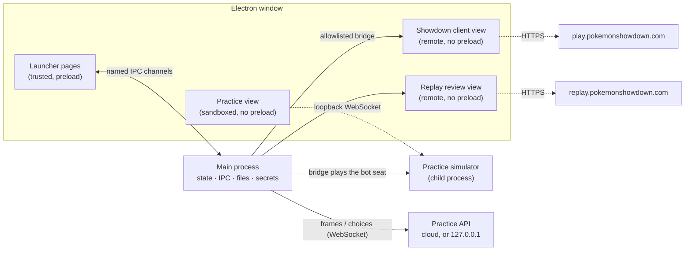

# Pokemon Showdown Evolved: design

This document describes what Pokemon Showdown Evolved is, how it is built, and why. It is the single reference for the app. Everything about the practice bots lives in [bots.md](bots.md).
## Contents

1. [Summary](#1-summary)
2. [Features](#2-features)
3. [Architecture](#3-architecture)
4. [Feature details](#4-feature-details)
5. [Key decisions](#5-key-decisions)
6. [Security and privacy](#6-security-and-privacy)
7. [Testing](#7-testing)
8. [Build, packaging and release](#8-build-packaging-and-release)
9. [Status, risks and open questions](#9-status-risks-and-open-questions)
10. [Appendix: visual design](#10-appendix-visual-design)

## 1. Summary

Pokemon Showdown Evolved is a free, open-source Electron app for Windows that hosts the **unmodified** official Pokémon Showdown client and adds tools around it.

A browser tab gives Showdown no stable home for tools, and offers no safe way to practise against bots: automated play on the public server would use a real account and the public ladder. The app keeps the client and its tools in one window and keeps practice entirely off the public server.

**Audience.** Existing Showdown players, especially Showdex users, who want a dedicated, dependable app. The bar is a clean, reliable integration rather than a bundle of add-ons. There is no subscription, launcher account or paid AI API.

## 2. Features

### Overview
- Overhaul of the Showdown **UI** and **navigation**
- Pinned Showdex **damage calculator**
- **Replay notes**, with in-app replay review and backup/restore
- **Battle review** gives a local summary, conditional attack comparisons and turn explanations for finished games and imported replays.
- **Practice** battles against **Foul Play**, a top ladder engine, and three simple offline bots

### Showdown client
- Official `play.pokemonshowdown.com` client in a persistent partition; sign-in survives restarts.
- Injected theme follows Appearance; type, HP and stat colors are never restyled.
- External links open in the system browser; only Google sign-in may open a popup.

### Showdown overhaul
- **Icon bar and room tabs:** a slim icon bar on the left for Home, Stats, Replay notes, Practice and Settings, with the account at the foot. Showdown rooms are tabs across the top, with close buttons and **Join a room**.
- **Battles persist** across page changes. A new battle takes focus; Home shows **Return to battle**; an ended battle offers **Save replay note**, **Close battle**, **Battle again**.
- **Home:** format and team pickers, **Battle**, **Cancel**, **Challenge a user**, the format's rating, win rate, record and GXE, plus news and editable chat room shortcuts. Two layouts, **Classic** and **Revamped**, chosen once in a first-launch welcome and switched in Settings.
- **Stats:** ladder totals and a sortable per-format table; **Play** preselects a format, never starts a search.
- **Restyled rooms:** Ladder, Teambuilder, Community, chat, battle and tournament rooms restyled by CSS only (`app/client-*.css`). All rules are scoped to `sd-launcher-shell`, so the stock client returns if the bridge stops.
- **Format picker:** the client's own picker shown as a centered modal.
- **Friends:** presence refreshed at most every 30 s.

### Showdex
- `npm run build:showdex` builds Showdex 1.4.2 at a pinned revision and verifies every asset against a SHA-256 manifest.
- Enabled in Settings, then an explicit client reload; a battle is never reloaded automatically. Failure leaves normal play intact.
- Packaged as an inert, verified payload with license and corresponding source; installed and enabled only on explicit opt-in.

### Replay notes
- **Notes:** a replay link plus title, format and notes. **Save replay note** on a battle prefills players and format; it never uploads.
- **Limits:** title 120 chars, notes 5,000, 1,000 notes / 8 MiB.
- **Search** over titles, formats and notes. **Ctrl+F** search, **Esc** clear, **Ctrl+S** save. Drafts survive navigation.
- **Review:** the official replay page opens beside the note, locked to that one replay. Showdown's player does all playback.
- **Backup:** **Export** to versioned JSON; **Import** previews new / unchanged / conflict notes (existing kept by default) and applies in one atomic write. **Undo import** works for the current session only.

### Battle review

A finished online or practice player battle offers **See Full Review** and **Not now**. Dismissing the offer leaves a review button on the result. Previously finished rooms keep that button, and spectator rooms do not raise the offer. Saved replay notes also provide **See Full Review**. In **Replays**, **Import replay…** accepts an official link, a downloaded Showdown HTML or JSON replay, or a text protocol log. Choosing a file or viewing the prompt starts no analysis. **See Full Review** runs the local reviewer and opens a tab with the result, player selector, game summary, comparison coverage, key moments and a turn-by-turn breakdown. Selecting another player uses the same report. A report opened from a saved note links back to its replay player.

**Feasibility and design review.** The earlier plan proposed rebuilding each turn for Foul Play and comparing its preferred choice to the player's. The ordinary replay lacks the battle requests that tell a player which moves and switches were legal, and it does not record intentions, hidden sets or counterfactual outcomes. Foul Play's search visit shares depend on its assumptions and budget. Converting those shares to chess-style mistakes or claiming a probability of winning would imply more evidence than the replay supplies. The current practice API offers move selection for its own sessions. A replay analysis endpoint would require a separate service, data contract and evaluation.

**What can be assessed.** The reviewer reconstructs the public position at the turn marker. Each row describes the opening position, the move or switch shown, the observed outcome and a coaching question. For example, the hazard row reports the number of layers already present and calls out a revealed Magic Bounce. A switch row can compare the incoming typing against an earlier attack, while leaving the opponent’s next choice open. A copied move, forced continuation, replacement, flinch or an attack stopped before execution can conceal the player’s selection. An explicit Tera declaration is a choice of its own. Only the declaring player’s assessment can use it on that turn. Ordinary misses and critical hits appear in outcomes because they can be guaranteed by the underlying mechanics.

**Turn stars.** Four stars mark the open damage route against a blocked alternative, or the higher listed base power in a matched pair. Two stars mark the reverse. The alternative is one named move the same Pokémon had already shown. These are ordinal labels. The turn cites the alternative and its reveal turn. Both moves must be ordinary, same-category, zero-priority opposing attacks. One condition compares an open direct attack with an immunity supported by public evidence, accounting for possible native abilities and unknown items that could lift the immunity. The other compares single-hit attacks of the same type, accuracy and mechanical flags, with different base power and no secondary effects. With common modifiers and the same roll, higher base power gives at least as much damage on a hit. Integer rounding and the target’s remaining HP can make the amounts equal. A known item is required for the power comparison, because an undisclosed Metronome can reverse the ordering. The comparison also withholds stars for Tera commitments, different secondary effects, possible Technician crossovers, known locks, possible PP exhaustion, selected field effects, ambiguous identities and other unresolved mechanics. If comparisons point in both directions the turn remains unstarred.

Both attacks must still be selectable and the opponent must stay as displayed for the comparison to apply. Unknown PP, hidden sets, protection, Illusion, switches, alternative objectives and future turns limit the interpretation. HP values are displayed percentages. Gen 9 rounds an injured Pokémon up to the next percent, caps it at 99 and reserves zero for fainting. The model never turns HP lost to a previous hit into a knockout threshold. A custom rules announcement disqualifies an otherwise recognizable tier. A manually stripped log can omit identifying information. The table covers 18 ordinary types, 911 species or formes, 349 fixed move typings and 167 direct attacks eligible for further checks. The pinned simulator supplies the facts and a local build can regenerate the comparison projection with `node scripts/practice/build-review-facts.cjs`. [Pinned simulator and license](../vendor/practice/SOURCE.md), [damage calculation](https://github.com/smogon/pokemon-showdown/blob/a9caa4cabe89459b00e717a47148d0f67b4451ae/sim/battle-actions.ts), [HP projection](https://github.com/smogon/pokemon-showdown/blob/a9caa4cabe89459b00e717a47148d0f67b4451ae/sim/pokemon.ts#L2060-L2093).

**Overall play rating.** The replay cannot establish an overall rating. The stars compare opening-target damage for a selected subset of attacks. An average would omit switches, setup, prediction and hidden legal alternatives, and the numerical distance between ordinal labels has no calibrated meaning. The report gives the outcome, representative turns, coverage, and counts of the two comparison labels. Evaluating strategic play would require a separately validated model for alternative actions, hidden information and multi-turn value, with expert comparisons on held-out games, uncertainty estimates and coverage reported by decision type.

**Sources and lifetime.** Online and practice capture require the current finished player's room, including a terminal win or tie in its player-side log. Reading a downloaded replay extracts the inert log text. A URL fetch requests the official HTTPS replay log and preserves a private link's access suffix. It omits credentials, rejects redirects and applies a deadline and streaming byte limit. Private team/request data, public chat and account metadata are excluded. The importer caps the input at 4 MiB and the retained battle log at 2 MiB, 30,000 lines and 1,000 turns. Rendering uses text nodes. The latest successful report stays in memory while the app is open. Cancellation, load failures and ordinary navigation preserve it. Reset, sign-out and closing the window clear it. Replay-note drafts and the official replay player keep their existing behavior.

The source format and exact HTML export are documented upstream. [Showdown simulator protocol](https://github.com/smogon/pokemon-showdown/blob/master/sim/SIM-PROTOCOL.md), [official replay API](https://github.com/smogon/pokemon-showdown-client/blob/master/WEB-API.md), [pinned replay exporter](https://github.com/smogon/pokemon-showdown-client/blob/49b54209ebee54ceb8fff62a5eb5bedf7efcf6dc/play.pokemonshowdown.com/src/battle-log.ts#L1811-L1845).

### Practice API (`api/`)
- **One interface for inference.** The battle always runs on the player's computer, on its own simulator. Only the bot's moves come from the practice API (`api/server.js`): on the cloud server by default, or, for a player who opts in, a copy the app runs on 127.0.0.1. The bot is Foul Play at three levels (Hard, Medium, Casual); Hard also plays OU.
- **A queue for the cloud.** When every cloud engine is busy, starting a Foul Play battle puts the player in line instead of failing: first come, first served, up to 20 waiting, one place per network. The battle tab shows **Waiting for a cloud engine** with the place in line (no time estimate; battles vary too much), **Leave queue**, and, if Foul Play is downloaded, **Play on this computer instead**. The app checks in every 3 s and the battle starts by itself when it is the player's turn; a place lapses after 15 s without a check-in, so a closed app never blocks the line. The Bots cards say "Cloud server busy · N waiting. You'll wait in line". Protocol: [api/README.md](../api/README.md#the-queue).
- **Cloud by default, local as an opt-in.** Foul Play plays on the cloud server unless the player downloads it. The Bots page's **Foul Play on this computer** panel downloads it (about 140 MB; `api/install.js` into the app's user data folder, building the search engine on first install), shows progress with **Cancel**, then offers **Cloud server / This computer** (saved as `practiceEngine`) and **Remove**. Nothing Foul Play-related is downloaded unless the player asks. Locally, the app starts the same API server on 127.0.0.1 with a private key, searching with up to 8 threads (the CPU's count, if lower) at below-normal priority. Closing the app mid-download asks first. Tests run the same server on loopback as a stand-in for the cloud.
- **Not bundled.** Foul Play (GPL-3.0) is installed only on the server (`api/install.js`, hash-checked against `api/lock.json`) and never shipped in the app.
- **Limits.** Anonymous access with per-network rate limits, a server-wide session cap and a thread cap; an optional API key ([api/README.md](../api/README.md)).
- **Hosting.** The default cloud server is one Google Cloud VM at `https://34-174-209-142.sslip.io` (`CLOUD_API_URL`). The API runs as a systemd service on `127.0.0.1:8787` behind Caddy, which provides HTTPS; only ports 80 and 443 are open. It serves 8 battles at once with 2 search threads each, so **Full** runs with 2 threads in the cloud. Step-by-step hosting: [api/README.md](../api/README.md#host-it-on-a-server).
- Battle review runs on the desktop. It does not call this API or occupy a Foul Play or Metamon slot.
- Protocol, limits and deployment: [api/README.md](../api/README.md) and [bots.md](bots.md).

### Practice
- Gen 9 Random Battle and Gen 9 OU on a private simulator on the player's computer, never the public server. Opponents: **Foul Play** (Hard), **Foul Play Medium** and **Foul Play Casual** (Medium), all on the cloud server, and three simple bots that run in the app (Easy: **Heuristic**, **Greedy**, **Random**). OU is Foul Play (Hard) only, with both teams chosen by the player.
- The **Bots** page (under Teambuilder in the sidebar, also reachable from **Play against bots** in the Home battle panel) lists the bots as cards with a **Play** button each; the battle plays in its own **Bot battle** tab with Forfeit, **New battle** and **End practice**. Closing that tab ends practice. Status shows thinking, turn, time and result.
- Practice and online games stay loaded side by side; the online account is never used.

### Settings
- Appearance, Home layout, Battle screen (launcher style or Showdown's original; applies at once, even mid-battle), start page, close protection for battles and searches, client reload, open logs. Where Foul Play runs (cloud or this computer) is chosen on the Bots page.
- **Sign out** clears the Showdown partition, local teams included. **Reset launcher** clears settings and replay notes but keeps the session. Both confirm first.
- Window size, position and maximized state are remembered.

## 3. Architecture

One Electron 45 window (Node 24) hosts four kinds of web content with different trust. The main process owns all state, files, child processes and secrets.



| Part | Where | Trust and isolation |
| --- | --- | --- |
| Main process (`app/main.js`) | Electron main | Windows, IPC, settings, replay storage, logs, practice lifecycle |
| Launcher pages (`renderer/*.html`) | `BrowserWindow` | `window.desktop` from `app/preload.js`; every call is a named, validated IPC channel |
| Showdown client | `WebContentsView`, partition `persist:showdown` | No preload, no Node; themed by injected CSS; popups only for Google sign-in |
| Showdown bridge (`app/showdown.js`) | Main, runs functions in the client page | Reads a sanitized snapshot; sends allowlisted actions |
| Replay review (`app/replay-review.js`) | `WebContentsView`, nonpersistent `replay-review` session | No preload, no Node; locked to the saved replay's path |
| Showdex (`app/showdex-integration.js`) | Custom scheme inside the client view | Optional, pinned, SHA-256-verified |
| Practice view (`app/practice-view.js`) | `WebContentsView` | Patched classic client; no preload, no Node; reaches only its session |
| Practice session (`app/practice-session.js`) | Main ↔ local simulator ↔ practice API | Runs the simulator, plays the bot's seat, relays only the bot's battle-room frames and validated choices ([bots.md](bots.md)) |
| Practice engines (`app/practice-engines.js`) | Main | Cloud API address, key and status |

### The Showdown bridge

Launcher pages ask main for a snapshot. Main runs `readClient()` inside the client page and sanitizes the result (IDs by regex, length-capped strings, checked sprite paths) into user, formats, teams, news, rooms and friends. Actions go the other way: search, cancel, challenge, join, focus-room, leave-room, edit-team, login, sounds, options. Each is validated against an allowlist, and arguments travel as JSON, never spliced into code. A session read sets `html.sd-launcher-shell` only when every client hook the shell needs exists. Otherwise the class is withdrawn and Showdown's own header and tabs come back (G2).

### Storage

| Data | Location | Notes |
| --- | --- | --- |
| Settings, window state | Electron userData (`%APPDATA%\showdown-desktop`) | Atomic writes (temp file, then rename) |
| Replay notes | userData `replays.json` | Versioned; a corrupt file is reported and never overwritten |
| Showdown login, teams, preferences | Partition `persist:showdown` | Separate from launcher data |
| Logs | userData | Fixed event names and numeric codes only |

`SHOWDOWN_DESKTOP_USER_DATA` selects an alternate profile for isolated tests.

### Repository layout

| Path | Contents |
| --- | --- |
| `app/` | Main-process modules, preload, injected client, replay and Showdex CSS |
| `renderer/` | Launcher pages (Home, Showdown, Practice, Replays, Settings), shared nav and styles |
| `api/` | Practice API: server, client, Foul Play installer and worker, deployment files ([README](../api/README.md)) |
| `scripts/practice/`, `scripts/bots/` | Practice simulator wrapper and runtime builders; the desktop bot suite |
| `vendor/practice/`, `vendor/showdex/` | Source pins, licenses, locks, patched practice client shell |
| `tests/` | Unit tests, Electron desktop and live drivers |
| `docs/` | This document and [bots.md](bots.md) |

## 4. Feature details

### Daily Bot Gauntlet Challenge

Home includes a compact cobalt Daily Bot Gauntlet Challenge strip in both layouts, with a yellow flame tile, highlighted active streak, remaining attempts, a Play daily action, and a Details link to Bots. The fuller challenge panel on Bots holds rules, best streak and total clears, and can also start or resume a daily attempt. Win one Gen 9 Random Battle against Foul Play Casual in at most three attempts per UTC calendar day. A clear adds exactly one day to the streak and locks further daily play until 00:00 UTC. Missing a day or finishing all three attempts without a win resets the current streak; personal best and total daily clears remain. Ordinary practice does not count and remains available.

The card offers Start challenge or Return to challenge, remaining attempts, current/best streak, lifetime clears, and the rules. Daily battles use the existing battle tab, with a guarded daily retry after a loss. Each retry starts a fresh session and random teams. Finish before midnight UTC: a late result cannot clear either the expired challenge or the next day's challenge. Ties and deliberate exits from active battles consume an attempt; cancelling setup or a detected runtime/engine failure refunds it. The app cannot resume a simulator after restart: an interrupted active attempt counts, while interrupted setup is refunded.

Progress is private to this launcher profile, stored atomically in `daily-challenge.json`. It uses the computer's UTC date, not an authenticated service clock. Backwards clock changes block new attempts until the stored day is reached; this is personal progression, not a tamper-proof competition or cross-device account system. Renderer IPC can request a start or read status, but cannot submit a result, choose the daily opponent, or edit counters. The main-process controller observes the simulator bridge. Corrupt files are preserved and disable challenge play; save failures fail closed. Reset settings/replay notes keeps daily progress, as the confirmation states.

Verification: daily state tests cover streaks, three attempts, ties, missed days, midnight, backwards clocks, duplicate results, restarts, failure refunds and failed/corrupt persistence. The isolated daily desktop test exercises real IPC and Home/battle navigation with simulated outcomes, captures both layouts/themes at both window sizes, and blocks public-client requests.

### Launcher shell and Home

- **Icon bar:** an 84px cobalt bar on the left; each page (Home, Teambuilder, Stats, Replay notes, Practice, Settings) is an icon with its name underneath, and the account avatar and name sit at the foot.
- **Page tabs:** the tab strip across the top of every page starts with small, label-width tabs for launcher pages, as in Showdown's own header. Home is always first and cannot be closed. Opening Stats, Replay notes, Practice or Settings from the icon bar adds its small tab after Home; it stays until closed or the app restarts, and closing the selected tab moves directly to the tab on its right, falling back to the left neighbor when it was the last tab. Closing a background tab keeps the selection. Teambuilder is the client's own room: its small tab is shown exactly while that room is open, and closing the tab leaves the room. **Community** (the client's main menu in its Community view, with its chat room list) also opens from the icon bar; its small tab appears whenever that view shows and stays until closed. Closing it uses the same neighboring-tab rule without switching through the client Battle menu. **Info & Resources** is a launcher page (`resources.html`): the help, tier and clause explanations, chat commands, ranks and shortcuts are written into the page, so nothing is fetched. The client's own resources room (Community's Info & Resources button) is closed as soon as a session read sees it, and this page opens instead. **Practice battle** opens when a practice battle starts and exists while that session does; closing it ends practice, asking first in the same forfeit popup while the battle is on. A wider gap separates these from the room tabs. **Ctrl+Tab** opens the tab to the right of the open one and **Ctrl+Shift+Tab** the one to its left, through page tabs, rooms and conversations, wrapping at the ends. **Ctrl+1** to **Ctrl+8** open that tab counted from the left (Ctrl+1 is always Home) and **Ctrl+9** opens the last one. **Ctrl+W** closes the open tab and a **middle click** closes the tab under the pointer, both exactly as the tab's close button would, so a live battle of your own still asks before forfeiting; Home has no close button and ignores both. The main process catches the keys, so they also work while the focus is inside the Showdown client, a replay or a practice battle.
- **Room tabs:** the normal-sized tabs that follow. One tab per open room (battles, chats, ladder) in the client's order with a close button, then conversations after a Messages label. There is no Battle tab: Home replaces the client's main menu. If the Showdown screen is left on that menu (outside an explicit tab switch), it returns to Home once two session reads agree, unless a client popup is waiting. Tabs sit flat on a darker strip with a short hairline between neighbours; the open tab takes the page colour, close buttons are always visible, and the hairlines beside it or beside a hovered tab drop away. Tabs share one width (up to 150px), shrink together to a 104px minimum, and then the strip scrolls (the mouse wheel scrolls it sideways). Closing an own live battle asks **Forfeit this battle?** in a small popup under the tab's close button (Forfeit or Cancel, as Showdown does; it fits over the top bar, since a battle view covers the page below), then sends the client's own `/forfeit` and leaves the room in the background, so the battle is never brought back on screen just to confirm. Other rooms close through the client's own leave path.
- **Persistence:** the client stays loaded across page changes, so navigating never loses a battle. A newly started battle switches to the Showdown view and takes priority. Home shows **Return to battle** while one runs. An ended battle shows a result bar: **Save replay note**, **Close battle**, **Battle again**.
- **Home hero:** format and team pickers (with the team's sprites: Showdown's 2D gen 5 style sprites, drawn pixelated, rather than the Teambuilder's 3D Pokémon HOME renders), **Battle**, **Cancel** and **Challenge a user**. Search runs in the background with an animated state. Choices are remembered per format as a convenience only.
- **Home hero record:** the selected format's rating, win rate, win–loss record and GXE, from the public profile endpoint (cached 2 minutes), with user and battle counts and **Edit teams** (opens the selected team).
- **Home layouts:** two layouts on one page, for two kinds of player. Either one shows the same hero, news and chat rooms; only the arrangement differs.
  - **Classic** (Showdown's main menu, modernised, for existing players): the hero as a column on the left with **Tournaments**, **Ladder** and **Spectate** tiles beneath it. On the right, **Latest news** over **Chat rooms** and **Friends** side by side, ending level with the tiles.
  - **Revamped** (for new players): one centred column, 820px at most. A wide hero with the record and **Teambuilder**, **Ladder**, **Watch** and **Your stats** shortcuts inside it, then **Latest news** and **Chat rooms** split 70/30. No friends window.
- **First-launch welcome:** shown on the first launch after installing, not on Showdown sign-in: it depends only on launcher settings, never on the Showdown account. While no layout is chosen (`homeLayout` is null), Home opens a modal with a small labelled copy of each layout (battle panel with **Battle!**, news, chat rooms, friends, shortcuts) in its real proportions, and says either can be changed in Settings. It cannot be dismissed without choosing. The choice is saved to launcher settings, so it is asked exactly once; only **Reset launcher** clears it. If settings cannot be read, Home shows Revamped and does not ask, since the answer could not be kept.
- **News:** each post in **Latest news** opens in place to its full text (click again to close) and stays open through Home's refreshes. The bridge reads a post as paragraphs of plain-text runs and links; links must be http(s) and are otherwise kept as text, and the post is bounded (20 paragraphs, 6,000 characters). Home never inserts the page's HTML. Links to a Showdown room (`play.pokemonshowdown.com/<room>`) join that room in the app; other links, **Open on pokemonshowdown.com** and **All news** open in the system browser.
- **Chat room shortcuts:** until edited, the five busiest rooms. **Edit** pins that list and lets the player remove rooms or add one by name (up to 12, duplicates ignored); from then on the list is theirs. Kept in the launcher page's local storage as a convenience.
- **Stats page:** a rail page with ladder totals (battles, win rate, highest rating, most played) and a sortable, filterable per-format table of rating, win rate, wins, losses, battles and GXE. **Play** on a row preselects that format on Home; it never starts a search.
- **Restyled client rooms:** the Ladder, Teambuilder, Community view, chat room list, live battle list, chat rooms, battle rooms and tournaments are the client's own pages restyled in place by `app/client-ladder.css`, `client-teambuilder.css`, `client-community.css`, `client-rooms.css`, `client-chat.css` (chat rooms), `client-battle-room.css` (battle rooms) and `client-tournament.css` (the tournament bar, bracket, tools, notices and bracket pop-out). They change surfaces, type and layout only; the client's markup and controls are untouched, and every rule is scoped to `sd-launcher-shell` so the client's own look returns if the bridge stops driving it. Battle rooms follow the "Cobalt Cards" mockup: the field, controls and log as separate square-cornered cards; a header row with the gimmick toggles (Mega, Z, Ultra Burst, Dynamax, Tera) and the timer; type-tinted move tiles with a type chip and PP (a type-coloured top edge in dark); switch cards with an HP bar and Active/Fainted notes; HP bars on the field with no card behind them; turn markers in the log. Every corner is square. The card layout applies only in the client's full layout (at least 830px wide and 571px tall); smaller windows keep the client's compact layouts with the same colours. The same rules apply to practice battles (scoped by `data-practice-state`). They are a separate stylesheet, injected only while Settings > Battle screen is Launcher style; choosing Showdown's original removes it live from the client and any practice battle. In the card layout a handle between the field and the log sets the width of the left column (640px up to whatever leaves the log 300px; a double-click resets it). The action picker stretches to the column, with its move tiles and switch cards (and their HP bars) widening; the field keeps its 640x360 size, centred on a backdrop as wide as the column. `app/battle-resize.js` adds the handle and backdrop in the client and in practice battles and sets `--sd-battle-width`; when a drag ends it logs the width to the console, and main saves it as `battleWidth` and passes it to the other view.
- **Friends pages:** the server's own `/friends` pages (All Friends, Spectate, Sent, Received, Help, Settings; rooms `view-friends-*`) restyled in place by `app/client-friends.css`, with the same scoping as the other client rooms. A **Friends** title over an underlined tab bar with **Refresh** at its right; friends as cards in a grid under status headings, with status chips in the app's colours; an inline **Add friend** field; request rows with **Accept** filled and **Deny** plain; settings as a label beside a two-choice segmented control, the current choice filled (Showdown marks it by disabling that button). The tab strip and top bar call every friends page **Friends**, with the page name as the top bar's status. **Open list** opens the page room at once (showing "Loading…" until the server's page arrives) or focuses an open one; it never passes through the main menu. **Challenge a user** likewise opens that user's conversation with the challenge form, not the bare main menu. `npm run test:desktop` renders each page from the server's markup, since the real pages need an autoconfirmed account the tests never use.
- **Responsiveness:** Home never waits on the network. Its read waits at most 150 ms for ratings and friends; anything slower finishes in the background while Home shows the last known values (or "Loading friends…"), then asks again after a second. Team sprites are worked out once per team (remembered by its packed text) rather than on every read, since that work runs in the page that also runs battles. Each launcher page draws its tab strip from the window's last session read at once, so switching tabs never flashes an empty strip. When the client opens or switches rooms itself (Community's room list, a link in chat), its address changes; main forwards that as a data-free `client:changed` cue and the page reads the session immediately, then once more 350 ms later for the room's title from the server, instead of waiting up to a second for the next poll.
- **Friends panel:** structured presence (online, idle, busy, offline as reported), refreshed at most every 30 s. **Open friends list** is the fallback. No battle state or avatars are inferred.

### Showdown client

- The official `play.pokemonshowdown.com` client in a persistent partition, so sign-in survives restarts.
- The injected theme follows Appearance and preserves Pokémon type, HP and stat colors.
- External links open in the system browser. Only Google sign-in may open a popup.

### Replay notes

- **Notes:** paste a link from Showdown's **Upload and share replay**, add a title, format and notes, and save. **Save replay note** on a battle prefills players and format but never uploads. Private links keep their access suffix.
- **Limits:** title 120 characters, notes 5,000, collection 1,000 entries / 8 MiB. Saved links are read-only. Adding a duplicate link offers the existing note.
- **Search and shortcuts:** search matches titles, formats and note text. **Ctrl+F** focuses search, **Escape** clears it, **Ctrl+S** saves.
- **Drafts:** unsaved drafts survive navigation. Closing the app with a draft asks before discarding it. Deleting a note never touches the hosted replay.

**Replay playback.** **Watch replay** opens the official replay page beside the same note editor. **See Full Review** runs the local battle reviewer described above. Showdown's player provides playback.
- **Controls:** **Hide notes** widens the player. **Reload replay** reloads only the replay. **Back to notes** closes the player and stops audio. **Open in browser** is explicit.
- **Locked to one replay:** main resolves the note ID to its validated URL; the renderer never supplies a URL. Navigation is limited to that exact replay path plus upstream playback parameters. If the page moves to a different replay, the view stops.
- **Failures and limits:** network, HTTP and renderer failures show an error with an explicit reload. Playback position is not kept.

**Backup and restore.**
- **Export notes…** writes every saved note (ignoring filters, excluding drafts) to versioned JSON through a native Save dialog. It refuses destinations inside the live profile, and a failed write keeps the previous file.
- **Import notes…** reads a file into a validated snapshot and opens a review window:

| Result | Meaning | Default |
| --- | --- | --- |
| New | No saved note has this exact link | Added with its saved dates |
| Unchanged | Link, title, format and notes all match | Skipped |
| Conflict | Same link, different content | Keep existing; per-note or bulk **Use imported** |

- **Applying an import:** it is one atomic write, and notes missing from the file are always kept.
- **What blocks it:** the file must pass validation as a whole (version 1, ≤ 8 MiB, no duplicates, valid URLs and dates); nothing is truncated or silently skipped. A preview goes stale if saved notes change meanwhile, and an open draft must be saved first.
- **Undo import…** restores the collection from before the last import that changed notes. It is available only within the app session and only while notes are unchanged. Session undo is not a backup history.

### Practice

- **Opponents:** Gen 9 Random Battle and OU on a private simulator the app starts on the player's computer. The Bots page has format tabs (**Random Battle**, **OU**) and one collapsible group per difficulty, hardest first: **Hard** (Foul Play), **Medium** (Foul Play Medium, Foul Play Casual) and **Easy** (Heuristic, Greedy, Random). The weaker levels are Random Battle only. The OU tab lists Foul Play only. Every card is the same size: icon and name, type and formats, a description and its own **Play** button. Nothing on the page says "unrated"; practice never touches the online account.
- **Where the bots run:** the simple bots run inside the app, offline ([bots.md](bots.md#simple-bots-appsimple-botsjs)). Foul Play, at every level, always runs on the cloud server, with nothing to install; only its cards show the server's state (online, busy, unreachable).
- **OU teams:** above the Hard group, a **Teams** section has two equal slots, **Your team** and **Foul Play's team**. Each takes an OU team from the Teambuilder (**My teams**) or a pasted export (**Paste a team**); the same team can go on both sides. There are no built-in or sample teams. Both teams are checked with the practice simulator's validator as they are chosen; Play stays disabled until both are legal, and an illegal or unreadable team shows the reason under its slot. The page remembers the last Teambuilder teams chosen; pasted teams are not saved. **New battle** keeps both teams. Teams are used for the game only, never kept or logged ([bots.md](bots.md#ou)).
- **No computation setting:** Foul Play always asks for the **Full** preset and gets what the server allows (currently 2 threads). The presets only ever set search threads, not strength, so the page no longer offers them.
- **Battle tab:** a card's **Play** opens a **Bot battle** tab (`practice-battle.html`) showing only the battle: the client's own header and room tabs are hidden, so the battle cannot be closed from inside it and leave an empty client. While a battle runs, the Bots page offers **Go to battle** instead of starting another.
- **Controls:** moves, switches and Terastallization in the battle; **Forfeit** (opens the client's confirmation), **New battle** after it ends, and **End practice** in the tab's header. Status shows starting, thinking, turn, elapsed time and result.
- **Account separation:** practice and online games stay loaded side by side, and the online account is never involved.
- How the bots decide, every protocol layer, performance and deployment: [bots.md](bots.md).

### Showdex (optional)

- **Build:** `npm run build:showdex` checks out Showdex 1.4.2 at a pinned revision and applies a recorded readiness patch. It verifies every asset against a committed SHA-256 manifest. Sources and the AGPL-3.0 license are in `vendor/showdex/SOURCE.md`.
- **First launch:** after choosing a Home layout, new users can choose Install Showdex or Not now. The answer is saved; existing profiles are not prompted on upgrade, and resetting settings does not repeat the Showdex offer. Skipping leaves Showdex disabled and creates no installed copy. Settings offers Install Showdex later.
- **Installation:** the app carries an inert, pinned payload plus its AGPL license and corresponding source archive. `ShowdexInstaller` copies into a staging directory under the profile, verifies runtime assets against the shipped manifest, and promotes the copy into `showdex/1.4.2`. Failed installs preserve an existing copy and leave a retry available. No terminal, external installer or download is needed. Installed files include the license, source record and source archive.
- **Enabling:** explicit installation enables Showdex and injects it into the existing client without reloading a battle. Later toggle changes retain the explicit client reload flow. Status reads Loaded only after Showdex has rendered; installation success alone does not claim it loaded. A failure leaves normal play intact. Existing developer opt-ins can still use the verified source-checkout bundle.
- **Look:** its chrome follows Appearance; calculator behavior and game colors stay upstream. It is excluded from packages until its distribution licensing is decided.
- **Battle dock:** `app/showdex-dock.js` arranges the existing Calcdex root to the right of chat: battlefield, chat, calculator. The battle's Showdex button hides/reopens it; selecting a Calcdex tab opens its matching battle. Both native panel and overlay modes are supported without changing the pinned bundle or saved Showdex preferences. Below 1250px of client width, chat moves below the battle controls in a scrolling column while the calculator stays visible on the right. The field scales to fit. Closing or switching battles removes the active dock; the online shell fail-safe restores native placement.
- **Bot battles:** installed/enabled Showdex is loaded into each new isolated practice session, with the same dock (battle, log, calculator). The scheme handler is registered before creating its renderer; only hash-verified assets and read-only Gen 9 Random Battle/OU preset and usage JSON endpoints are added to its request allowlist. No login/account requests or arbitrary external fetches are allowed. The practice CSP explicitly permits the Showdex scheme and metadata host; it is not bypassed. A battle received before Showdex finishes booting is initialized from its existing state without replaying turns. Changes to the global Showdex toggle apply on the next bot session. Optional asset setup failure leaves the battle playable.
- **Dock verification:** `npm run test:showdex:dock` loads the real client and Showdex in an isolated guest profile with synthetic received battle logs. It checks both themes, three window sizes, hide/show, tab navigation, native overlay mode, battle HP synchronization and cleanup. Outbound sends are intercepted. This is integration coverage, not a signed-in public battle test.
- **Bot verification:** `npm run test:practice:showdex` installs the real pinned Showdex bundle and starts a real Foul Play battle through the simulator and a loopback instance of the inference API. It asserts nonzero calculated damage ranges, column order, move/switch/Tera handling, both themes/window sizes, rematches, and session cleanup. No public ladder battle or account is used.

### Settings

- **Options:** Appearance (system, light, dark), Home layout (Classic, Revamped), Battle screen (Launcher style, Showdown's original), start page, close protection for battles and searches, explicit client reload, open logs.
- **Sign out** clears the Showdown partition, including local teams (export them first). **Reset launcher** clears settings, preferences and replay notes but keeps the Showdown session. Both confirm first.
- **Window:** size, position and maximized state are remembered. A saved window is repositioned if its monitor is gone.

## 5. Key decisions

| # | Decision | Alternative | Rationale |
| --- | --- | --- | --- |
| D1 | Host the unmodified official client | Fork or re-implement it | Stays current with Showdown; added layers can fail without breaking play (G2) |
| D2 | Reach the client only through a sanitized, allowlisted bridge from main | Give remote views a preload or Node | The client is remote content; a fixed list of named actions bounds the attack surface |
| D3 | Separate `persist:showdown` partition | Share launcher storage | Sign-in survives restarts; Sign out and Reset launcher clear one without the other |
| D4 | Launcher-owned room navigation, with a fail-safe | Keep Showdown's own tabs | One consistent rail; if client hooks change, the client's tabs return automatically |
| D5 | Replay notes store links, not replays | Download replay archives | Showdown hosts replays; local data stays small, private and portable |
| D6 | Import reviews conflicts and keeps existing notes by default | Overwrite or mirror the backup | Restoring must never silently lose notes |
| D7 | Foul Play plays on the hosted API by default; running it on the player's computer is an opt-in download | Bundle Foul Play with every release; cloud only | Owner decisions (2026-11-13, 2026-11-17 evening): Foul Play is too large for the base release and the hosted API serves everyone regardless of CPU, so the cloud stays the default. The morning of 2026-11-17 local play was removed to keep GPL-3.0 code out of the app; that evening it returned as an opt-in, since the project's license (AGPL-3.0-or-later, matching the shipped AGPL client) is compatible with Foul Play's GPL-3.0 |
| D7a | The simulator runs on the player's computer; only inference is remote | Run whole battles on the server | Owner decision (2026-11-16): a server that only searches, and a battle UI that never depends on the network. Foul Play only for now; anonymous access with rate limits |
| D7b | Host the cloud API on one VM behind Caddy, named through sslip.io | Own domain; managed containers; Docker on the VM | Owner decision (2026-11-16): no domain to buy or manage, and a plain systemd service is simple to update with `git pull`. The hostname is derived from the static IP, so changing the IP means a new app build |
| D8 | Practice on a private simulator with loopback enforced twice | Bot plays on the public server | Automated play on real accounts is impossible by construction ([bots.md §3.4](bots.md#34-network-confinement)) |
| D9 | Presets are thread counts, not offered on the page | Named difficulty levels; a Computation picker | That is all they change; strength is not measured, and the server caps them anyway |
| D10 | Every third-party input pinned by revision or hash | Track upstream | Reproducible builds and a recorded license position per component |

Bot-internal decisions (thread pools, rejected-choice handling, pooling) are recorded in [bots.md](bots.md).

## 6. Security and privacy

- **No automated play on real accounts.** The app and its tests never search, challenge or play on the user's account. Live tests are guest-only and spectate.
- **Least privilege per view.** Only launcher pages have a preload. Remote views are sandboxed and context-isolated and deny permissions; downloads and popups are blocked. The Showdown client is denied notifications; the launcher shows them itself.
- **Electron fuses.** Packages disable `NODE_OPTIONS` and `--inspect`, load the app only from a hash-checked `app.asar`, and encrypt cookies (the Showdown login) with the OS key store. `runAsNode` stays on because the practice simulator runs as an `ELECTRON_RUN_AS_NODE` child.
- **Validated IPC.** Every privileged request is validated in main. The renderer never supplies file paths (native dialogs choose them) or replay URLs (main resolves them from note IDs).
- **Text, not HTML.** Imported and snapshot text is rendered as text.
- **Private logs.** Fixed event names and numeric codes only: no usernames, credentials, replay URLs or note text.
- **Practice API.** Session IDs are 256-bit capabilities and are never access-logged. The local API binds to 127.0.0.1 with a per-launch key and refuses browser upgrades. Choices from any API are checked against the move grammar twice (server and app) before reaching the simulator. The hosted API listens only on loopback behind Caddy, which keeps no access log, and rate limits use the client address Caddy forwards.
- **Explicit destructive actions.** Sign out, reset, discarding drafts and undoing imports all confirm first.

## 7. Testing

### November 23 battle reviewer accuracy audit

**Zero of 1,318 visible choices received a revised turn grade** across 23 public games, 739 turns and 46 player perspectives. The original model rated 393 of 1,312 choices it identified, including 283 four-star and 19 five-star results. The two versions also differed on which copied, forced and Tera actions they counted. The sample combines the seven previously saved public games with the first eight OU and first eight Random Battle entries from the public replay search sampled before inspecting outcomes. It measures coverage in those games. No player performance labels or expert ground truth were available.

| Public replay sample | Games | Turns | Previously starred | Revised comparisons |
| --- | ---: | ---: | ---: | ---: |
| Original OU and Random Battle replays | 7 | 365 | 158 | 0 |
| Additional OU and Random Battle replays | 16 | 374 | 235 | 0 |

The two additional eight-game groups are identified below by their official replay IDs. Examples from the sample include a 14-turn Random Battle and a 203-turn OU game. [14-turn Random Battle](https://replay.pokemonshowdown.com/gen9randombattle-2718460432), [203-turn OU](https://replay.pokemonshowdown.com/gen9ou-2718458081), [additional OU sample](https://replay.pokemonshowdown.com/gen9ou-2718563098), [additional Random Battle sample](https://replay.pokemonshowdown.com/gen9randombattle-2718562330).

<details><summary>Replay IDs for reproducing the coverage check</summary>

| Group | Format | Numeric IDs |
| --- | --- | --- |
| Original | gen9ou | 2718456637, 2718458081 |
| Original | gen9randombattle | 2718459860, 2718460432, 2718461607, 2718462531, 2718465400 |
| Additional | gen9ou | 2718563098, 2718559594, 2718562799, 2718560507, 2718560055, 2718562244, 2718560214, 2718558682 |
| Additional | gen9randombattle | 2718562330, 2718559924, 2718561422, 2718561013, 2718560712, 2718560855, 2718559509, 2718560634 |

</details>

**Independent mechanics checks.** The pinned Showdown simulator validated the OU teams and generated 24 seeded battles for the test oracle. Corviknight’s Drill Peck and Peck provided a controlled power comparison in both directions. At one remaining HP, both Peck and Drill Peck knocked out Bergmite from the same turn opening. Staraptor’s Tackle and Aerial Ace against Sinistcha exercised blocked and open attacks. Other paired runs exposed why broader judgments fail. With identical public openings, Flamigo’s Close Combat against a switching Gholdengo produced an immunity with Costar and a 77-percentage-point loss with hidden Scrappy. A level-1 Rookidee with a hidden Metronome dealt 2 actual HP with 35-base-power Peck and 1 HP with 80-base-power Drill Peck. The reference runs also verified Tera’s 60-power floor, Technician, Pressure and Spite, Dig, Magic Bounce, Psychic Terrain and Poison Heal. A separate test compares all 324 chart cells and every bundled species type, native ability set and ordinary attack record with the simulator. The simulator and hidden HP are used by the tests only. [Controlled oracle tests](../tests/battle-review-oracle.test.js), [turn-state regressions](../tests/battle-review-state.test.js).

**Verification.** Windows syntax checks and 344 unit tests passed with zero skips. All 14 isolated desktop suites passed. The reviewer desktop suite verifies both empty and populated comparison filters, real IPC/worker behavior and light/dark layouts. A real loopback Foul Play game exercised the practice review offer, return and rematch. An isolated Electron ASAR loaded the worker, comparison module and data. Signed-in public battles, packaging an installer, release and host deployment were outside this audit.

### November 20 security, reliability and performance audit

Audited from `371de12` on `codex/full-app-audit`. Reviewed the Electron trust
boundaries, IPC and navigation policies, optional downloads, local stores,
practice startup/cancellation, API/worker limits, runtime integrity and release
configuration. The audit produced these source fixes:

| Finding | Fix and regression evidence |
| --- | --- |
| Worker input could accumulate without a memory bound while the engine was busy | The Python reader now blocks at 16 queued frames, preserving pipe backpressure so the API can terminate a flooding session. Python slow-consumer/order tests and an API stalled-worker test cover both boundaries. |
| An embedded subframe could spoof the battle-width console message and write launcher settings | Only the expected main frame may persist battle width. The Electron security suite verifies a hostile iframe is rejected and the real main-frame path still works. |
| Download write errors could crash the process or hang cancellation | A stream pipeline handles disk failure, abort, hashing and partial-file cleanup. Tests exercise a real write error in a child process and cancellation of a stalled stream. |
| Failed runtime promotion could leave the previous installation displaced | A failed staging rename restores the prior runtime. A simulated Windows `EPERM` verifies rollback and a subsequent successful replacement. |
| Cancelled practice startup could interfere with its replacement | Stale verification completion preserves the newer cancellation handle; late API queue replies release their reservations before touching current state. Both races have regression tests. |
| Searching a full replay library blocked the renderer for over 100 ms | Reused locale date formatters reduced the sampled filter handler median from 117.3 to 11.1 ms and maximum from 131.5 to 14.1 ms with 1,000 notes of 5,000 characters each. Full-list load fell from 355 to 175 ms. |

Verification on the development Windows PC:

- Syntax checks and **270 Node test cases passed, zero skips**, with the real
  simulator root enabled and the local Python runtime present. The worker wrapper
  also runs three Python backpressure/input tests.
- All **12 isolated desktop suites** passed. Guest live startup, shell, Showdex,
  Showdex dock, appearance and replay playback passed. Real Foul Play practice
  with Showdex passed move, switch, Tera, rematch, theme/size and failure cleanup.
- Two complete local Hard OU games (14 and 12 turns, 30 decisions, median 312 ms)
  and two hosted Medium Random Battles (12 and 15 turns, 32 decisions, median
  119 ms) passed. These are private practice sessions, not public account games.
- Full root, API and simulator production npm audits reported **zero known
  vulnerabilities**. `pip-audit` found no known vulnerabilities in the ten
  installed runtime Python packages. A bounded tracked-source credential-pattern
  scan found no matches; it is not proof that every possible secret is absent.
- The generated practice runtime was stale against its source. Rebuilt it and
  passed source/runtime packaging verification with manifest
  `a4026e465d5e7dd773690d7f2a70d645ff64b6053b0c0a4626cc3d392cbe1f78`.
- Live startup measured Home at 373 ms, connected formats at 2.40 s and page
  navigation at 24–88 ms. A separate 30-navigation sample with Showdex enabled
  had a 51.4 ms median / 70.6 ms p95; session IPC was 1.3 ms median / 2.9 ms p95.
  Main-process event-loop delay p99 was 19.3 ms, maximum 27.8 ms. No launcher
  errors or accumulating WebContents were observed.

The performance probe is a short warm-development sample, not a long-session
leak test or a low-end hardware guarantee. Total Chromium/app working set varied
around 1.1–1.4 GiB across probes, including live upstream content; main-process
RSS stayed around 160–180 MiB. The live client remains a significant memory cost.
Raw logs, measurements and the temporary probe are in ignored
`out/full-app-audit/`; screenshots are in the existing ignored capture folders.

The shell and practice screenshot harnesses also needed real paint activity:
transparent background windows can suspend animation frames and freeze Showdex
midway through a theme transition. Shell capture now drives its flicker observer;
practice captures use an opaque surface and assert that calculator text and
background both reach the selected palette.
One additional practice run timed out restoring the network-blocked online view
before the capture checks; the unchanged retry passed. That intermittent harness
visibility check remains a candidate for further soak testing.

No installer was rebuilt, no release was edited, and no hosted service was
deployed. **The worker queue fix requires a service deployment to protect the
hosted API**; the hosted games exercised the existing deployment. Signed-in
account flows, clean-machine installation/upgrades, macOS/Linux and prolonged
soak testing remain outside this audit. Passing tests and clean advisory scans
cannot establish that the app has no remaining defects or security flaws.

### November 19 final Evolved audit

The visible product name is **Pokemon Showdown Evolved**, including page titles,
onboarding, notifications and future Windows package names. The application ID,
npm package name, environment variables and profile directory remain stable for
existing users. The profile test covers both old and new product names.

Verified on the development PC:

- Syntax checks and 241 tests passed with no skips when
  `PRACTICE_TEST_SERVER_ROOT` points at `vendor/practice/dist/server`.
- All nine isolated desktop suites passed, as did guest live shell, Showdex,
  Showdex dock, official replay playback and real Foul Play/Showdex practice.
- Two full hosted Medium Random Battles completed (26 and 22 turns; 50 decisions,
  median 118 ms). Two loopback Hard OU battles completed (16 and 32 turns;
  52 decisions, median 235 ms). Rematches and cleanup passed.
- The new `npm run test:startup:live` checks guest startup, both themes, all six
  launcher pages, horizontal overflow, broken images and launcher console errors.
  Its sample measured Home ready 239 ms from harness entry, connected client and
  formats at 2.23 s, and page navigation at 19–83 ms. These are warm development
  measurements, not cold installed-app or low-end hardware guarantees.
- App (full and production), API and bundled simulator production npm audits
  reported zero known vulnerabilities. Package source/runtime verification passed.
- README media were visually inspected: actual guest/practice captures, the owner
  logo and an attributed Showdown Eevee sprite. Generated test output stays ignored.

Fixed deprecated Electron console handlers and bounded practice API JSON while
streaming, so an oversized response is cancelled before buffering the rest.
Regression tests cover cancellation, UTF-8 byte counts and invalid responses.
Practice's blocked ladder/account and unrelated Showdex API requests are expected
isolation behavior; actual calculations and battle controls passed.

No public account battles, account challenges, server deployment, installer rebuild
or clean-machine acceptance were performed. Signed-in verification and installer
acceptance remain release requirements. This audit is not a guarantee against
future upstream client changes.


Electron is pinned to 45.3.4. The dependency override upgrades only affected
`minimatch` versions (7 through 11.0.0) to 11.0.1 for GHSA-g3hv-75wg-m249;
older unaffected consumers retain their compatible APIs. The build dependency
test exercises electron-builder's actual file filters and the universal build
allowlist matcher without creating an installer. Reassess the override when
updating electron-builder. The live shell test waits for battle metadata as well
as the tab: the server can deliver the initial turn after the tab appears.

November 18 release follow-up: added a per-profile single-instance lock, verified
by starting a second Electron process, so concurrent launchers cannot overwrite
each other's settings and notes. Canonicalized IPv6 network keys (including
embedded IPv4) and rejected invalid forwarded addresses in the practice API.
The top-level npm audit did not cover the bundled simulator: its separate scan
found four affected packages, including a critical websocket-driver advisory.
The simulator now uses a committed production dependency lock with mysql2
3.24.6, websocket-driver 0.7.5 and uuid 11.1.1. Packaging checks both dependency
files against the runtime inventory and requires a rebuild after changes.
Upstream game source remains at its pinned revision. The rebuilt simulator's
production audit reports zero vulnerabilities, as do the app and API audits.
Showdex's right-panel navigation now focuses the tool in the launcher's single
panel, with upstream behavior retained when the shell fail-safe disengages.

224 unit tests passed (one optional skip), and all seven desktop suites passed
after the instance-lock change. Guest shell, replay and Showdex checks passed;
real loopback practice passed again against the rebuilt simulator. An isolated offline sample
measured a 208 ms warm development launch, 17–53 ms page loads, a 5 ms maximum
session IPC round trip and 31 ms main-loop p99 delay. These do not measure
network latency or clean-machine performance. No real-account actions or
production server changes were made.

The follow-up unpacked Windows build passed both packaged smokes, including a
real move through the hosted practice API, navigation retention, forfeit/rematch
and process cleanup with a restricted PATH. Its isolated startup sample was
429 ms; the practice battle was ready in 3.1 s. New dependency pins and their
builder use fixed LF line endings so Git checkout does not invalidate the byte
inventory. This is not a clean-machine installer or signed-in acceptance test.

Earlier November 18 launch audit: 222 unit tests (one optional skip), all seven desktop
suites, the practice suite (a real Foul Play battle), live shell and replay checks,
two battles against the hosted API (median 240 ms per decision), and both packaged
smokes with fuses on. Three desktop suites had gone stale against current behavior
and were updated. Guest performance: Home ready 195 ms after launch, client
connected 4.7 s, every page 17–65 ms in both themes. Of about 1.1 GB working set,
about 320 MB is three ad iframes Showdown's own page loads. npm audit: zero.

November 16 audit follow-up: syntax, 152 unit tests (one optional skip), all seven
isolated desktop suites, live shell and live replay review passed on Electron
45.3.3. Full and production-only npm audits reported zero vulnerabilities. A
fresh guest performance probe measured Home ready at 180 ms from script entry,
the connected shell at 2.8 s, and page navigation at 25–74 ms in both themes and
window sizes. These are development-PC samples, not cold installed-app startup,
low-end hardware or sustained-memory guarantees. No installer was rebuilt and
no hosted bot deployment was changed.

November 16 practice API deployment: 157 unit tests (one optional skip) and
`npm run check` passed. `tests/practice-api-live.cjs --url` played two full
battles from a development PC against the hosted server over HTTPS (11 and 25
turns, 38 decisions, median 248 ms per decision at 2 threads). The Electron
practice suites were not rerun against the hosted server.

| Command | Covers |
| --- | --- |
| `npm run check` | Syntax |
| `npm test` | Unit tests: bridge sanitization, action validation, navigation timing, challenges and messages, settings, replay storage and imports, practice manifest, runtime and session bridge, practice API server and client, bot integrity |
| `npm run test:desktop` | Electron suites with temporary profiles and simulated Showdown responses (outbound client traffic blocked): connection recovery, view survival and sizing, themes, battle auto-switch, replay notes, review and import. Screenshots go to `out/desktop-smoke/` |
| `npm run test:shell:live` | Guest, spectate-only drift check of the client hooks the shell depends on. Run before each release |
| `npm run test:showdex:live`, `npm run test:replays:live` | Guest-only checks of a real Showdex build and a real public replay, in both themes and sizes |
| `npm run smoke:packaged` | The unpacked package with a fresh profile, system-only PATH and the public client blocked |
| Bot suites | Real games against Foul Play through a loopback copy of the API server or the hosted one (`--url`), ([bots.md §6](bots.md#6-running-and-hosting)) |

No suite verifies a signed-in account. Those checks are manual and owner-only (section 9).

## 8. Build, packaging and release

**Run from source** (Node.js 24):

```sh
npm install
npm start
```

For Showdex development, run `npm run build:showdex`; new users can then install it during setup or from Settings. Packaging now requires this verified payload, including its license and source archive.

**Packaging** (`electron-builder` 26.18.0, always `--publish never`):

```sh
npm run build:practice   # required: packages bundle the practice simulator and battle client
npm run pack:win:dir     # unpacked app for inspection
npm run smoke:packaged
npm run smoke:practice-packaged
npm run pack:win         # unsigned per-user x64 NSIS installer in out/windows/
```

- **Installer:** adds a Start menu shortcut but no desktop shortcut, and uses Electron's default icon until branding is decided.
- **`app.asar`:** contains `app/`, `renderer/`, `api/client.js`, `api/protocol.js`, `package.json` and the optional Showdex installation payload with license and source archive. It never contains tests, scripts, `out/` or credentials. Showdex is not installed into the profile or enabled until the player opts in.
- **Foul Play is not in the release** (D7). It plays on the cloud server unless the player downloads it from the Bots page. For that opt-in, the app ships `api/client.js`, `protocol.js`, `install.js`, `server.js`, `lock.json` and the GPL-3.0-derived worker `api/worker/foulplay_worker.py`, unpacked from app.asar so Python can read it. The after-pack check fails the build if any other `api/` file is packaged or anything else is unpacked. No Python or Foul Play ships; the download fetches the pinned Python, Foul Play source, packages and set data.
- **Practice simulator runtime:** `build:practice` builds only the pinned Showdown server, the patched battle client and their source archives (a `simulator` manifest, about 290 MB). It ships outside the archive under `resources/practice`, with `server.cjs` alone under `resources/practice-adapter`. Before- and after-pack hooks re-verify every file and refuse any other runtime kind, and packaging fails on any drift.
- **Dependency audit:** `npm audit` reports zero vulnerabilities for the app and `api/`.
- **Fuses:** set in `electron-builder.yml` (see section 6); `npx @electron/fuses read --app <exe>` shows them.

**Release path** (original plan; see the automatic-update section below for current behavior).

1. Prove a clean Windows 11 install, upgrade between two versions, uninstall and reinstall, as a standard user at 100% and 125% scaling.
2. Decide Showdex inclusion and meet the AGPL/GPL source obligations (project license: AGPL-3.0-or-later, decided 2026-11-19).
3. Settle app identity (icon, publisher name) and code signing.
4. Build reproducible, versioned GitHub Releases with checksums, notices and install notes.
5. Run an invited alpha with 8–12 Showdex users, fix launch, data-loss and battle-interruption defects, then publish a public alpha.
6. Add automatic updates once manual upgrades are proven. Never restart during a battle.

## 9. Status, risks and open questions

**Status** *(snapshot)*

| Area | State |
| --- | --- |
| Shell, Home, client, replay notes, review, backup, Showdex, settings | Implemented; automated suites pass |
| Practice (Foul Play) | Implemented: cloud by default, opt-in local download |
| Hosted practice API | Live on one Google Cloud VM over HTTPS; two real battles verified end to end. Docker image untested |
| Windows installer | Builds and passes packaged smoke tests; never tested on a clean machine |
| Public release | Not started |

**Risks**

| Risk | Effect | Mitigation |
| --- | --- | --- |
| Showdown client changes | Bridge reads or theme selectors break; a switch to Showdown's new Preact client would need a bridge rewrite | Fail-safe shell; `test:shell:live` before releases |
| Licensing | AGPL/GPL obligations for the patched client, Foul Play and Showdex | Source and notices retained; owner review before release |
| Hosted API capacity and reachability | One VM serves 8 battles at once at 2 threads; anonymous access invites abuse; the sslip.io hostname breaks if the static IP is released | Per-network rate limits and caps; tests use a loopback copy of the server; keep the IP reserved; add `API_KEY` or accounts, more VMs, or a domain if usage grows |
| Unproven demand | Users may not return | Invited alpha measures return use before more features |
| Local Foul Play supply chain | Downloads are SHA-256 pinned, but pip packages are pinned by version only and poke-engine's build dependencies (maturin) and crates resolve at install time | Add `--require-hashes` pins and a pinned, hash-checked build backend before promoting local play |

**Open decisions (owner)**

- [x] Project license: AGPL-3.0-or-later (2026-11-19), compatible with the patched AGPL client, GPL-3.0 Foul Play and AGPL Showdex.
- [ ] Code signing and release branding.
- [x] Showdex is an optional first-launch installation from a bundled payload; packaging includes source and license. The installer has not been rebuilt for this feature.
- [ ] Whether the hosted API stays anonymous, and whether it moves to a proper domain (the current hostname is tied to the VM's IP).

**Verification outstanding**

- [ ] Signed-in checks by the owner: session persistence, ratings, team selection, challenges, a real search becoming a battle, friends data, rail forfeit prompt, result bar.
- [ ] Clean-machine install, upgrade and uninstall (release step 1).
- [ ] The Docker image (`api/deploy/`), and the in-app Foul Play install on Windows and macOS.
- [ ] The Electron practice suites against the hosted server, and its behavior with several players at once.

**Not designed yet:** incoming challenges and PMs inside the launcher, a replacement for Showdown's own home screen, Practice view chrome, practice formats beyond Gen 9 Random Battle, macOS and Linux packages.

## 10. Appendix: visual design

Two themes share one identity: a cobalt rail, a cobalt Home hero and a Showdown-yellow primary button. Light is **Cobalt**; dark is **Steel blue**, deliberately blue rather than charcoal or grey. Components use role tokens only. A color change edits both theme blocks of `renderer/styles.css` and the matching `--sd-*` value in `app/client-theme.css`.

| Token | Cobalt (light) | Steel blue (dark) | Use |
| --- | --- | --- | --- |
| `--bg-app` | `#e6ecf5` | `#24304a` | Window background |
| `--bg-panel` | `#ffffff` | `#2c3a57` | Panels and cards |
| `--text` | `#15223a` | `#f1f4fa` | Primary text |
| `--accent` | `#2459b8` | `#7db2ff` | Links, focus, selection |
| `--primary` | `#f5c42c` | `#f5c42c` | One primary button per region |
| `--rail-bg` | `#1f4b9a` | `#193f85` | Navigation rail |

### Publishing the first Windows preview

The v0.2.0 GitHub prerelease uses the owner-supplied Eevee logo for the app,
installer and uninstaller. `renderer/assets/app.ico` is a format conversion of
`logo.png`, with 16, 24, 32, 48, 64, 128 and 256 px images. `win.icon` controls
the executable; the NSIS icon options control setup, removal and its header.
The BrowserWindow also explicitly uses that icon during development.

Publish from a clean, committed tree: build, run both packaged smoke commands,
record the source commit and SHA-256, push an annotated version tag, create a
draft release, upload the installer and checksums, inspect its assets, then
publish as a prerelease. Keep each public version fixed; changes get a new
version and tag. GitHub provides source archives for the tag, and the installer
retains bundled upstream licenses and corresponding source archives.

The original public 0.2.0 files use manual updates. The replacement candidate below adds guarded updates. Clean-PC installation/uninstallation and signed-in acceptance testing remain pending. Windows remains unsigned. No app telemetry is added.

Download counts are available without app telemetry through GitHub:

```powershell
gh api repos/influxtion/Pokemon-Showdown-Launcher-App/releases/tags/v0.2.0 --jq ' .assets[] | {name, download_count}'
```

Count the installer asset separately from checksum/source downloads. Downloads
are not unique users or successful installations. Repository Insights > Traffic
provides a rolling 14-day visitor/clone window; save snapshots if long-term
traffic history is needed.


## Automatic updates (November 19, 2026)

The replacement 0.2.0 candidate uses pinned `electron-updater` 6.8.11. Installed Windows NSIS and Linux AppImage builds check GitHub Releases 30 seconds after startup and every six hours, including preview releases. Downloads are automatic and hash-checked. Settings also offers Check for updates, shows progress/errors, and exposes Restart to update only after the download completes. A small rail label points to Settings when an update is ready. Development builds never check; Mac and unpacked Linux builds link to the Releases page. The owner chose manual Mac updates because no Developer ID certificate is available.

`app/updates.js` owns update state and sets `autoInstallOnAppQuit=false` before any download. No download, ordinary quit, or elapsed timer installs anything. Installation requires an explicit click and a native confirmation. Main checks current session state both before and after that confirmation, with bounded reads. It refuses unknown/disconnected client state, all unfinished battle rooms (including spectators and rooms whose player names have not arrived), pending searches/challenges, starting/active practice, unsaved replay state or a cached draft, and conflicting installs/imports/exports. The restart action is available only while Settings is the current fully loaded page, so the user cannot type into a note during the final checks. Failed reads block installation. Existing profile paths and saved data stay unchanged.

The updater follows the configured public GitHub repository without embedding credentials. Windows is unsigned: SHA-512 verifies downloaded bytes against GitHub metadata, not an independent publisher identity. Native code signing remains a future task. Mac automatic installation stays disabled. Linux tar.gz remains a manual alternative. The private publishing token is never shipped to clients.

All packaging scripts use `--publish never`. The release-candidate workflow has only `contents: read` and uploads Actions artifacts for review. It builds pinned Showdex on Windows, then native Windows, Apple Silicon, Intel Mac, and Linux x64 packages. Generated Windows and Linux manifests (`latest.yml`, `latest-linux.yml`) and the Windows blockmap must accompany their corresponding binaries. Do not rename an update binary without regenerating metadata. Upload every binary first and metadata last, preferably to a draft release for future versions. Keep each future version increasing. The owner reports no current 0.2.0 users and requested a replacement candidate; replacing that tag/files requires explicit approval of the exact release text and file list. Never publish from a source push automatically.

Tests cover automatic download without quit hooks, cancellation, duplicate requests, state changes during confirmation, practice/search/battle/draft blocking, retries, and manual builds. The Electron suite uses a loopback feed and the real updater to check a newer download, corrupt SHA-512 rejection, same/older versions, and actual launcher IPC/UI guards. Its payload is inert and is never executed. This does not claim a clean-machine installer upgrade or Mac signing test.

## Home design exploration (November 19, 2026)

The owner rejected the first TCG-inspired layout and copy. The current direction
preserves the desktop app's arrangement and wording, adds warmer and more
interesting colors and border choices, and gives Home more breathing room.
The saved Home preference is Classic. Do not turn this into a mobile-style
dashboard, add a promotional greeting, or replace familiar labels.

On `feat/home-ui-rehaul`, `npm run preview:home` opens an isolated Electron
appearance preview using the current `renderer/index.html` and `styles.css`.
`mockups/home-themes.css` provides appearance and spacing overrides;
`mockups/home-themes.js` provides palettes and clearly labeled sample data.
`mockups/preview-home.cjs` owns the preview window and native comparison menus.
The production renderer and saved settings are unchanged. The rejected mockup
was removed; its historical source remains in commit `b9ef00d`.

The desktop menus offer six palettes (Hearth, Garden, Seaside, Rosewood, Amber,
Twilight), light/dark versions of each, four border finishes (fine, soft inset,
double frame, stitched), three corner sizes, and Current/Relaxed/Airy spacing.
Hearth with Relaxed spacing is the initial suggestion. Classic and the existing
Revamped layout can both be inspected. The palette uses cream or deep colored
surfaces, differently tinted panel headers, colored rail icons, warmer yellow
actions, and optional subtle texture. These are intentional explorations beyond
the older flat color and border rules.

Relaxed spacing increases Home margins, column separation, panel padding,
control heights, and list-row spacing while softening dividers. It retains
the compact desktop rail, room tabs, daily strip, and Classic's battle/news/
rooms/friends arrangement. Home scrolls vertically at smaller window sizes.
The menus are design-review controls, not a proposed production navigation bar.

The owner clarified that the additional space should be between boxes. The
subsequent increase in outer margins, panel padding, and control spacing was
reverted. Relaxed retains its earlier outer spacing, with 48 px
between main columns, 40 px between panel rows, and 36 px between Chat rooms
and Friends. Airy increases only those panel gaps further. Minimum-width
layouts use 32 px between major columns and 28 px between the lower panels.
Panel padding was then reduced at the owner's request: the battle panel uses
18–20 px, news and room rows use 8–16 px, and Friends uses 12–16 px. These
tighter interiors retain the wider gaps between boxes in both spacing modes.
Only the gap below Daily Bot Gauntlet Challenge is tighter at 20 px in Relaxed and Airy;
the other panel gaps retain their chosen spacing.
The top inset above Daily Bot Gauntlet Challenge is also 20 px at both desktop widths.

The preview has no launcher preload or account session and performs no
matchmaking, bot startup, or external navigation. Artwork includes the
existing local logo and keystone, plus optional Showdown wallpapers described
below. The guest, daily state, news, and room list
are sample content labeled in the preview chrome. Battle/search/cancel and
the format picker demonstrate local states. Reopening resets the study.

Verification includes script syntax, contrast checks for all twelve palette
variants, captures of light/dark and multiple border treatments, desktop and
minimum-size overflow checks, and format/search/cancel interactions. Generated
pages and captures are in ignored `out/home-themes/`. This remains a design
preview, not verification of a production Home implementation.

Daily Bot Gauntlet Challenge was removed from the preview's sample news at the owner's
request; the dedicated daily strip remains.

### Showdown background feasibility (November 19, 2026)

Image backgrounds are technically feasible for Home without changing its
desktop layout. The existing image CSP permits local assets and the official
Showdown origin. An isolated Electron experiment decoded all five backgrounds
used by the classic client's random selection: Charizards (1500×891), Horizon
(1280×853), Ocean (1500×1000), Shaymin (1280×800), and Pokemon Showdown Day
(2000×967). The current picker explicitly offers the first four, Solid blue,
Random, and a custom image; Showdown Day is part of the random pool.
Sources: [background storage and attribution](https://github.com/smogon/pokemon-showdown-client/blob/1cf9b385a97ad5c77a25b91a1c799078827ec306/play.pokemonshowdown.com/src/oldclient/storage.js#L30-L118),
[background picker](https://github.com/smogon/pokemon-showdown-client/blob/1cf9b385a97ad5c77a25b91a1c799078827ec306/play.pokemonshowdown.com/src/oldclient/client-topbar.js#L868-L934),
and [hosted assets](https://play.pokemonshowdown.com/fx/).

The experiment placed Ocean behind the Seaside Home panels with a light tint,
preserving opaque content surfaces and the existing gaps. Desktop and minimum
window sizes had no horizontal overflow. The capture was visually inspected;
it is saved at ignored `out/home-themes/background-ocean-study.png`, with its
temporary harness at `out/home-background-feasibility.cjs`. This was a hidden
research window; the normal preview's background, production files and saved
preferences were not changed. It does not establish startup performance or
offline behavior for a shipped feature.

Suggested implementation: a Home background choice independent of the color
palette, starting with Plain color and a small allowlisted image catalog,
with cover cropping, per-image positioning, a theme-aware tint, and a visible
artist credit. Load artwork asynchronously and keep the palette color as the
loading/offline fallback. A cached or bundled copy would make the desktop
experience independent of a network fetch after first use. Upstream credits
Vivian Zou (Horizon), Quanyails (Sunrise Ocean), Daniel Kong (Shaymin), Jessica
Valencia (Charizards), and LifeisDANK (Showdown Day); this check did not establish
an image-specific redistribution grant, so retain those credits and resolve
asset distribution terms before bundling exact artwork.

Home and the embedded Showdown client have separate storage. Matching an
existing Showdown choice would require a narrow, sanitized background ID in
the bridge; arbitrary CSS or custom data URLs should not be copied through it.
The embedded client's art is currently suppressed by the explicit `body`
background rule in `app/client-theme.css`. A Home-only background needs no
change to that stylesheet or to battle rendering. Restoring client wallpaper
or importing custom local images would be separate extensions.

The owner subsequently requested backgrounds in the mockup. The native
Background menu now offers Plain color, Ocean, Horizon, Shaymin, Charizards,
and Showdown Day. Ocean starts selected with the existing Hearth palette.
Artwork tint offers Natural, Soft, and Muted; Soft mixes in 12% of the palette
background in light appearance and 24% in dark appearance. The artist credit
appears in the top bar.

The mockup loads only the five allowlisted images from Showdown's image host
under the existing CSP. It displays the palette background while decoding,
falls back to it on failure or a 12-second timeout, and ignores stale loads
after another selection. No wallpaper files are bundled or added to the
production app. Verification covered all five images, credits, both
appearances, both layouts at minimum size, rapid switching, plain color, and
a blocked-network fallback in an isolated Electron session. Captures are in
ignored `out/home-themes/background-*.png`.

To expose more of the wallpaper, Relaxed now uses 80 px between the main
columns, 64 px between panel rows, and 56 px between Chat rooms and Friends.
Airy uses 104/80/72 px respectively. The small-window horizontal gaps are
48/40 px in Relaxed and 64/56 px in Airy. Shortcut tiles have 24 px gaps in
Relaxed and 32 px in Airy. Outer padding and panel interiors stay unchanged;
the gaps above and below Daily Bot Gauntlet Challenge remain 20 px, verified by rendered
geometry.

The owner clarified that wallpaper must fill the whole Home screen: the
Show whole image default left unwanted bands. Background > Image framing now
defaults to Fill window (`cover`), centered in the Home viewport with only
the proportional crop required to cover it. Show whole image (`contain`)
remains an optional comparison. The wallpaper is sized to the viewport rather than the
scrolling content, so expanding news or scrolling does not enlarge it.
Checked all five images, desktop and minimum widths in both layouts, image
framing choices, and unchanged hero padding; no horizontal overflow.

Home's panel fills now use 80% opacity (20% transparency) when artwork is loaded: Battle, News,
Chat rooms, Friends, the daily strip, and shortcut tiles let a little of the
wallpaper through. Text and controls stay fully opaque, as do panel headers.
Secondary panel text mixes 80% toward the primary text color. The Battle
gradient and dark panel fills are deepened, and light daily/tile text is
slightly darkened, to preserve contrast at the increased transparency. Plain-color and loading
fallbacks retain solid panels. There is no panel-level opacity or backdrop
blur. Rendered color checks across all twelve palette variants, compositing
the fills over both black and white, gave a minimum 4.61:1 for the checked
primary, secondary, daily, tile, and Battle text. Ocean and the busier
Charizards artwork were visually inspected in light/dark captures; desktop
and minimum-size layout checks passed.

The default Hearth colors were then rebalanced around soft blue News, seafoam
Chat rooms, and apricot Friends headers, with a cooler ivory surface and
bluer Battle panel. The matching dark colors use blue, deep seafoam, and
warm brown. The other five palettes remain available for comparison.

Classic's right-hand group now caps at 620 px instead of stretching across
all remaining width. With the existing 56 px gap, Chat rooms and Friends
are 282 px wide each at the desktop preview size. News uses a 280 px height
and the lower pair 260 px, reducing unused space while preserving the wide
panel gaps and Battle's dimensions. The group contracts with the available
space at smaller widths; News gets 300 px height below 1180 px to accommodate
wrapped text. Checked desktop/minimum layouts, news expand/collapse, and
all twelve palette contrast combinations; the checked minimum remains 4.61:1.
The three-box group is aligned to the right edge of its grid column at the
owner's request, preserving its sizes and the existing outer inset.

### Home appearance implementation (November 19, 2026)

The approved study is now the real Home screen. The six palettes (Hearth,
Garden, Seaside, Rosewood, Amber, Twilight), five Showdown wallpapers plus
plain color, tint, framing, four border finishes, three corner sizes, three
spacing choices, and plain-background texture are saved in launcher settings.
Home's Customize Home link opens Settings at Home appearance; See Home returns
to the working screen. Defaults are Twilight, Ocean, Soft tint, Fill Home,
Soft inset borders, Soft corners, Relaxed spacing, and subtle plain texture.
The background is a fixed saved choice, not random. Existing Home layout and
app appearance preferences are preserved; palettes follow native light/dark
appearance, including system changes.

`renderer/home-appearance-options.js` supplies the same catalog/defaults and
allowlists to the settings store, Home, Settings, and isolated preview.
`renderer/home-appearance.js` applies tokens and bounded asynchronous artwork
loading. `renderer/home-appearance.css` is loaded only on Home. The mockup uses
these production files while retaining its separate sample data. Home's real
Showdown snapshot/actions, daily challenge, news expansion, and navigation stay
in their existing controllers. No new IPC or arbitrary artwork URL is exposed.

The art remains hosted by Showdown, with a visible artist credit. A failed or
12-second image load leaves solid palette panels and does not block Home;
stale completion cannot replace a newer selection. Fill uses the Home viewport
and proportional cropping, not the height of scrolling content. Artwork is
not bundled, and this change makes no offline artwork availability guarantee.
Loaded panels retain 20% transparency with solid controls and text. The compact
daily gaps, reduced interiors, smaller right-aligned secondary panels, and
larger inter-panel gaps match the approved study.

Validation: syntax checks and 252 unit tests passed (one optional real-server
test skipped), and all eleven isolated desktop suites passed. The Home desktop suite exercises real settings IPC, persistence,
all palettes/background choices, native theme changes, both layouts at 1440x900
and 1024x640, daily spacing, news expansion without duplicate summaries, client
preservation, and offline fallback. Rendered checked text contrast across all
twelve palette variants remained at least 4.61:1 against both extreme artwork
colors. All five actual hosted images decoded in the optional live-art run;
screenshots were inspected. The rest of the desktop regression suite uses
blocked launcher artwork requests to remain isolated. No installer or release
is part of this change.

A separate fresh guest profile also loaded the production Home against live
Showdown, with real formats, news, room counts, and the Ocean artwork. No search,
challenge, or signed-in account was used; that review window was left open.

The owner subsequently selected Twilight as the default palette. Existing
saved palette choices are retained. Classic's Tournament/Ladder/Spectate
shortcuts now sit 20 px below Battle in Relaxed and Airy, rather than 64/80 px.
Daily's 20 px gaps and the wider gaps among the right-hand panels are unchanged.

### App-wide appearance (November 19, 2026)

The owner approved extending the Home design throughout the desktop app. Every
launcher page now loads the shared palette and artwork controller, plus
`renderer/app-appearance.css` for Settings, Bots, Stats, replay notes/review,
resources and battle placeholders. Colors & style in Settings controls all six
palettes, backgrounds, framing, tint, border finishes, corners and spacing.
Twilight remains the default; existing saved choices and internal `home*`
preference names are preserved. Settings previews saved changes immediately.

The shared catalog now exports pure color tokens for both renderer and main.
`app/appearance.js` generates validated user-origin CSS for explicitly registered
Showdown, practice and replay views. Each document owns one replaceable sheet;
palette changes do not reload it or interrupt a battle. Main-document navigation
invalidates pending insertions; subframes and same-document navigation do not.
OAuth windows receive no appearance controller. No IPC or remote privileges
were added. Window/view fills also follow the selected palette.

Teambuilder, Community, Ladder, chat-room and spectate lists receive the selected
wallpaper with translucent cards. Reading headers, form controls and buttons
stay solid; Friends uses a reading panel around its page. Plain color works
without network access. The art stays proportional to the visible viewport and
keeps its credit in the launcher bar. The existing Home arrangement, shortcuts,
daily gaps and wording are retained, apart from the customization link now
being named Colors & style.

Chat, tournament chrome, online/practice battles, replay playback and Showdex
use matching colors and softer corners. Battle and calculator reading surfaces
remain solid. Battlefields, sprites, Pokémon types, HP/status colors and
calculator game colors keep their existing treatment. The optional launcher
battle stylesheet owns the new move/switch/card rounding, so the original
Showdown battle-style choice still bypasses those rules. Practice/replay views
make no new wallpaper requests; their native battlefield artwork remains intact.

Validation includes syntax checks, 255 passing unit tests (one optional
real-server test skipped), and twelve isolated desktop suites. The new app
appearance suite checks seven real launcher pages in both themes at 1366×768
and 1024×640, real Settings IPC, immediate palette/corner changes in the retained
client, solid controls and horizontal fit. Friends fixtures now use the shared
Twilight sheet. The Daily desktop harness waits for initial Home navigation
before driving another load, fixing a test startup race.

`npm run test:appearance:live` checks actual hosted artwork and the real guest
Teambuilder, Community, Ladder, room browser, spectate list and chat at both
sizes/themes, plus four native screens. Live Showdex, dock and public replay
playback suites passed. The real loopback Foul Play/Showdex suite passed moves,
switching, Tera, rematch, theme/size checks and lifecycle cleanup on rerun; its
first run timed out waiting for a switch control, and now records state and a
screenshot on that failure. Screenshots of native pages, remote pages and
battle/calculator surfaces were inspected. Signed-in friends/account behavior,
public account battles, installer packaging and public releases were not part
of this appearance change.

November 20 correction: Bots and Teambuilder always use the selected palette's
plain color, with solid panels and
no wallpaper, background texture or gradient. The shared artwork preference
still applies elsewhere. Bots skips artwork loading entirely; the play shell
follows the active room and hides the artwork credit on the plain tabs. These
page policies do not overwrite the saved background choice. Community,
including its room browser, uses the selected wallpaper again at the owner's
request, with translucent cards and the artwork credit restored.
Syntax checks, the Home and app appearance desktop suites, and the live guest
appearance suite passed; the plain tabs were visually checked in the
captured light/dark desktop layouts.

Daily Bot Gauntlet Challenge now sits after the opponent groups on Bots. Its Home card and
Bots header use the palette's rose/plum surface (Twilight), with a coral edge
and a lightly tinted Bots body. Other palettes use their matching surface.
The inactive flame is muted; the active streak flame keeps its lit color.
Syntax checks and the existing Daily/Home appearance desktop suites passed;
both Bots themes were inspected, and Home's twelve palette contrast checks
remain at least 4.61:1.

The owner rejected the remaining orange/gold accents on Daily Bot Gauntlet Challenge.
Its updated treatment uses a cool periwinkle surface, violet action button and
edge, and blue lit flame on both Home and Bots. Dedicated light/dark daily
tokens replace the shared warm accents, including button shadows and the Home
emblem. Its position below the bot choices is retained.
Syntax, Daily desktop flow and Home appearance checks passed; the twelve
palette contrast checks still meet 4.61:1. Light/dark screenshots were inspected.

Foul Play Casual's Bots card now includes a violet Play daily shortcut beside
its regular Play action. Both daily entry points share the same controller,
availability, start lock and existing main-process attempt reservation. A
running challenge shows Return to daily; a completed challenge shows a disabled
Cleared today button. Rebuilding cards after format changes restores this state.
Errors from the shortcut reveal the daily panel's error message. The footer
wraps the connection status above the two actions at narrow card widths.
Syntax and the Daily/app appearance desktop suites passed. Checks cover the
Medium-only action, format changes, one attempt when both entry points are
clicked, returning without another reservation, completed-state disabling and
light/dark card fit. No live daily attempt was consumed during verification.

The owner subsequently swapped the Bots sections: Daily Bot Gauntlet Challenge now sits in
the former local-download position above the opponent groups, and Foul Play on
this computer sits below those groups. Daily is shorter: its action shares the
title/streak row, its description, attempts and record wrap along one line,
and its existing expandable rules stay below. Home and the Casual card's daily
shortcut keep their layouts and behavior.
Syntax checks and the Daily/app appearance desktop suites passed; both desktop
sizes and themes were visually checked with the compact strip above the cards.

The Medium card footer now keeps its connection status and both actions on one
row. The action buttons have narrower horizontal padding, smaller text and no
fixed minimum width; their height is retained. Long connection messages can
wrap within the status area without pushing the buttons onto another row.
Syntax and the Daily desktop suite passed, with light/dark footer captures
inspected, including the longer Cleared today label.

Classic Home's battle panel uses a middle ground after the owner found the
compact revision too short: 16px vertical padding, 14px section gaps, 36px
selects, a 50px Battle button and team previews capped at 52px. This restores
about 56px of height while remaining shorter than the original. The separate
panels retain their spacing; shorter windows use normal Home scrolling.
Syntax and the Home appearance desktop suite passed; light/dark captures
were inspected with the restored spacing.

Tab closing now shares one selection rule across launcher pages, Community,
Teambuilder, client rooms, conversations and bot battles: select the tab to
the right, or the left neighbor for the final tab. Background closes preserve
the current selection. Close buttons, middle clicks and Ctrl+W use this path.
Client closes and successor selection run in one validated bridge call so the
client's fallback room does not paint. Reads begun before or during a close
cannot render stale state or redirect a navigation already in progress; the
cached strip is refreshed before crossing back to the client page. Failed or
cancelled closes keep the tab, including failed practice stops.

Verified with syntax checks, 262 passing unit tests (one optional real-server
test skipped), all 12 isolated desktop suites, and the live guest shell suite.
Regressions cover delayed reads, client-change events, right/left selection,
native/client transitions, background closes and forfeit guards. Live frame
sampling observed no intermediate main-menu frame during client tab closes.
The live suite used only a disposable guest profile and spectated battles.

Home now paints its connecting state with [Gen 9] Random Battle, Team is
provided, all six random-team slots, the final action controls and unknown
online/battle counts already in place. The default stays Gen 9 Random Battle
when formats arrive; an existing saved format choice still restores normally.
Controls require both a real format snapshot and a connected session, and
Edit teams is guarded during startup. Transient snapshot failures retain the
last usable layout and retry promptly; team selections survive reconnects.
Classic shares a reserved profile area between account text and ladder stats;
Revamped keeps its shortcuts above the stats so late ratings cannot move them.

Verified syntax, 262 unit tests (one optional real-server test skipped), Home
appearance and desktop smoke suites. The delayed-startup checks compare panel,
field, team, action, shortcut and side-box geometry before connection, after
connection, after sign-in and after ratings arrive, in both layouts/themes at
1366x768 and 1024x640. All tested bounds remain within one CSS pixel. Connecting
and connected captures were visually inspected; saved formats and reconnect
team selection were checked through real launcher IPC with simulated sessions.


## November 21: expanded practice roster

Foul Play Casual and Medium now support OU alongside Hard. All three support Gen 9 Anything Goes, with a format tab, per-format validation for both teams, pinned AG usage stats, crowned-form export handling and duplicate-species reserve tracking. Switching formats invalidates pending validation and ignores stale Teambuilder replies. The Bots page checks the cloud host's per-bot format capabilities and offers runtime updates for older local Foul Play installs.

Historical implementation, superseded by Optional bot downloads below: Metamon's Kakuna policy was a cloud-only Gen 9 OU opponent. This followed the owner's earlier instruction to avoid increasing player install/download size. Its model, Python, CPU inference dependencies and installer stay in the server-only `api/metamon/` directory; the desktop package's existing API allowlist excludes them. The local Foul Play setting cannot redirect Metamon, and queued Metamon sessions cannot switch to local Foul Play. The Bots footer credits Metamon as well as Foul Play. See `docs/bots.md` for exact setup, pins, licensing, adapter behavior and limitations.

Verified: 280 Node tests with zero skips, isolated roster UI checks in both themes at 1366x768 and 1024x640, real Casual/Medium OU games, Casual/Medium/Hard AG games including duplicate Miraidon sets, a clean Metamon runtime install and two real API-backed Kakuna games with rematch. These use private local simulators/API servers; they do not deploy anything to the friend-owned host. All 13 desktop suites passed across the full run and a friends-suite retry after a screenshot UnknownVizError. The simulator was rebuilt and packaging source verification passed. No public accounts, installer build, release upload or production deployment.


## Optional bot downloads - November 21, 2026

Bots now has a Downloads tab alongside Random Battle, OU and Anything Goes. It shows Foul Play and Metamon once each, without difficulty groups or Play actions. The play tabs retain their roster layout. Both engines default to cloud; downloads and execution preferences are independent. Metamon offers Kakuna CPU inference for OU with an optional 572 MB checkpoint and runtime, keeping the app installer small. The existing Foul Play footer remains, and a small Metamon credit names Jake Grigsby, UT Austin RPL and contributors. MIT source and Apache 2.0 model notices accompany the download; details and pinned sources are in docs/bots.md and api/metamon.

Download management uses fixed profile directories and practice-page IPC checks, cancellation, removal confirmation, active local battle guards and a recheck after confirmation. Each local engine owns its authenticated loopback API and closes it before replacement/removal. Model and runtime files are excluded from the package allowlist.

Verified: syntax checks, 283 unit tests with zero skips, all 13 desktop suites and an expanded roster/downloads suite covering real IPC, cancel/retry/removal, separate preferences and local Metamon routing. Inspected Downloads captures in both themes at 1366x768 and 1024x640. The actual Windows Metamon installer completed with retained notices, and two local OU battles finished (13 and 14 turns). No installer build, public release or hosted deployment.


## Eligible bot queue and host budgets - November 21, 2026

The shared bot queue now admits the earliest eligible player, skipping blocked Metamon tickets while preserving their place and both total/model session caps. Eligible queued players retain priority over newcomers. Hosted admission adds CPU and RAM reservations, live memory headroom checks and capacity retention until terminated workers exit. Defaults reserve at least 25% CPU (whole-thread rounding, minimum one usable thread) and max(1 GiB, 25%) RAM. Foul Play reserves 512 MiB and Metamon 2 GiB per session. These estimates can be raised; aggregate budgets can be tightened. Implementation, configuration, regression and real-battle evidence, and host-sizing limits are in docs/bots.md. Source is ready for the friend's host; no remote deployment or installer/release work occurred.

Verified syntax, 292 unit tests with zero skips (including package allowlist checks), standalone API startup with effective resource reporting, two real Metamon OU battles and two Medium Random Battles under explicit resource budgets. No renderer changes or desktop-suite rerun for this server-only change. Windows loopback verification does not establish capacity or cgroup behavior on the Linux host.
